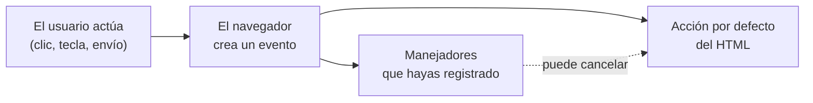

# 1. Eventos en el HTML

[⬅️ Volver a la unidad](./README.md)

## Índice

- [1.1. Qué ofrece el HTML para la interacción](#11-qué-ofrece-el-html-para-la-interacción)
- [1.2. Comportamientos que el HTML ya trae](#12-comportamientos-que-el-html-ya-trae)
  - [1.2.1. Acciones por defecto](#121-acciones-por-defecto)
  - [1.2.2. Elementos interactivos sin JavaScript](#122-elementos-interactivos-sin-javascript)
- [1.3. Los atributos manejadores `on…`](#13-los-atributos-manejadores-on)
  - [1.3.1. Cómo funcionan por dentro](#131-cómo-funcionan-por-dentro)
  - [1.3.2. `return false`](#132-return-false)
- [1.4. Por qué no usar los atributos `on…`](#14-por-qué-no-usar-los-atributos-on)
- [1.5. Las propiedades `on…` en JavaScript](#15-las-propiedades-on-en-javascript)
- [1.6. Comparativa de las tres formas](#16-comparativa-de-las-tres-formas)
- [1.7. Ejemplo integrador: migrar una página con `onclick`](#17-ejemplo-integrador-migrar-una-página-con-onclick)
- [Resumen](#resumen)
- [Ejercicios de reflexión](#ejercicios-de-reflexión)

> **CE que trabaja este tema:** RA5 a.

---

## 1.1. Qué ofrece el HTML para la interacción

En la UD5 asociaste acciones a los eventos con `addEventListener`. Antes de profundizar en ese modelo, conviene saber qué puede hacer **el propio lenguaje de marcas** con los eventos, porque:

- Mucha interacción **ya la resuelve el HTML** sin una línea de JavaScript: enviar un formulario, seguir un enlace, desplegar un `<details>`, marcar una casilla.
- El HTML tiene una forma propia de **capturar eventos**: los **atributos manejadores** (*event handler attributes*) como `onclick`. Los verás en código heredado, en tutoriales antiguos y en algunos frameworks, así que tienes que reconocerlos y saber por qué no se usan.



El diagrama resume la idea del tema: ante cada acción del usuario, el navegador crea un evento, ejecuta los manejadores registrados y, salvo que alguno lo cancele, aplica la **acción por defecto** que define el HTML.

---

## 1.2. Comportamientos que el HTML ya trae

### 1.2.1. Acciones por defecto

Muchos eventos tienen una **acción por defecto** (*default action*): lo que hace el navegador si nadie lo impide.

| Evento | Sobre | Acción por defecto |
|--------|-------|--------------------|
| `click` | `<a href>` | Navegar al enlace |
| `click` | `<button>` dentro de un `<form>` | Enviar el formulario (su `type` por defecto es `submit`) |
| `click` | `<input type="checkbox">` | Marcar o desmarcar la casilla |
| `click` | `<label for="campo">` | Activar el campo asociado (le da el foco o lo marca) |
| `submit` | `<form>` | Enviar los datos a la URL de `action` y cargar la respuesta |
| `keydown` | Campo de texto | Escribir el carácter |
| `contextmenu` | Cualquier elemento | Abrir el menú contextual |
| `wheel` | Página o elemento con desplazamiento | Desplazar el contenido |

En el tema 2 verás cómo **cancelar** estas acciones con `evento.preventDefault()`: es lo que hace un formulario validado con JavaScript (tema 5).

> ⚠️ **Cuidado**: Un `<button>` dentro de un `<form>` **envía el formulario** aunque no lo pretendas, porque su tipo por defecto es `submit`. Los botones que no envían (abrir un panel, añadir una línea) llevan siempre `type="button"`.

### 1.2.2. Elementos interactivos sin JavaScript

El HTML moderno incluye elementos y atributos que reaccionan al usuario por sí solos y que, además, **lanzan eventos** que tu código puede escuchar:

| Elemento o atributo | Qué hace solo | Evento que lanza |
|---------------------|---------------|------------------|
| `<details>` y `<summary>` | Muestra u oculta su contenido al pulsar el resumen | `toggle` |
| `<dialog>` + `<form method="dialog">` | Cierra el diálogo al enviar el formulario | `close`, `cancel` (tecla Escape) |
| `popover` + `popovertarget` | Un botón abre y cierra un elemento emergente | `beforetoggle`, `toggle` |
| `required`, `pattern`, `type="email"`… | Impide enviar un formulario con datos no válidos y muestra un mensaje | `invalid` (tema 5) |
| ``, `<script>`, `<link>` | Cargan un recurso | `load`, `error` |
| `autofocus` | Pone el foco en el campo al cargar | `focus` |

```html
<details id="ayuda">
  <summary>¿Cómo se calcula el precio?</summary>
  <p>Precio base más un 21 % de IVA.</p>
</details>

<button popovertarget="info">Más información</button>
<div id="info" popover>Envío gratis a partir de 50 €.</div>
```

```js
// El HTML ya abre y cierra; JavaScript solo se entera de lo que pasa
document.querySelector('#ayuda').addEventListener('toggle', (evento) => {
  console.log(evento.target.open ? 'Ayuda abierta' : 'Ayuda cerrada');
});
```

> ✅ **Buena práctica**: Antes de programar una interacción, comprueba si el HTML ya la ofrece. Un `<details>` es accesible con el teclado y con lectores de pantalla sin que hagas nada; un acordeón hecho a mano tienes que hacerlo accesible tú. Es la **mejora progresiva** de la UD5.

> 📝 **Nota del Profesor**: El atributo `popover` y los botones con `popovertarget` son recientes (Baseline desde 2024). Consulta Baseline en MDN antes de usarlos si tu aplicación tiene que funcionar en navegadores antiguos (UD5, tema 6).

---

## 1.3. Los atributos manejadores `on…`

Cada evento tiene un **atributo** HTML con su nombre precedido de `on`: `onclick`, `oninput`, `onsubmit`, `onload`, `onkeydown`… Su valor es **código JavaScript** que se ejecuta cuando ocurre el evento.

```html
<button onclick="alert('Hola')">Saludar</button>

<form onsubmit="return comprobar()">
  <input name="email" oninput="contar(this)">
  <button>Enviar</button>
</form>


```

Es la forma **más antigua** de capturar eventos (nació con Netscape 2 en 1995) y todos los navegadores la siguen admitiendo.

### 1.3.1. Cómo funcionan por dentro

El navegador convierte el texto del atributo en el **cuerpo de una función** que recibe el evento en una variable llamada `event`:

```html
<button onclick="console.log(event.type, this.textContent)">Pulsar</button>
```

```js
// Lo que crea el navegador, más o menos:
boton.onclick = function (event) {
  console.log(event.type, this.textContent);
};
// Salida al pulsar: click Pulsar
```

| Dentro del atributo | Vale |
|---------------------|------|
| `event` | El objeto evento |
| `this` | El elemento que tiene el atributo |
| Nombres sueltos (`comprobar()`) | Se buscan en el elemento, en su formulario, en `document` y, por último, en el **ámbito global** |

> 💡 **Tip del Examinador**: "¿Qué valen `this` y `event` dentro de `onclick="…"`?" → `this` es el elemento que tiene el atributo y `event` es el objeto evento, que el navegador pasa como parámetro a la función que crea con el texto del atributo.

### 1.3.2. `return false`

En un atributo `on…` (y en una propiedad `on…`, apartado 1.5), devolver `false` **cancela la acción por defecto**:

```html
<a href="https://ejemplo.com" onclick="return confirm('¿Salir de la página?')">Ir a ejemplo.com</a>
```

Si el usuario pulsa «Cancelar», `confirm` devuelve `false`, el manejador también y el enlace no se sigue.

> ⚠️ **Cuidado**: `return false` **no** funciona con `addEventListener`: allí se usa `evento.preventDefault()` (tema 2). Es una diferencia que confunde mucho al migrar código antiguo.

---

## 1.4. Por qué no usar los atributos `on…`

| Problema | Por qué |
|----------|---------|
| **Mezcla las capas** | El comportamiento queda dentro del contenido (UD5, tema 7). Para cambiar qué hace un botón hay que tocar el HTML |
| **No funciona con módulos** | El código del atributo solo ve el **ámbito global**. Las funciones de un `<script type="module">` no son globales: `onclick="guardar()"` da `ReferenceError: guardar is not defined` |
| **Un solo manejador por evento** | No se pueden añadir dos manejadores al `click` del mismo elemento sin juntarlos a mano |
| **Código en texto** | Sin resaltado de sintaxis, sin ESLint, difícil de depurar y fácil de romper con unas comillas |
| **Seguridad** | Una **política de seguridad de contenido** (*Content Security Policy*, CSP) estricta bloquea los manejadores en línea, porque son la vía típica de un ataque XSS (UD4) |
| **Repetición** | Veinte botones iguales llevan veinte atributos iguales; con la delegación (tema 2) basta un oyente |

```html
<!-- index.html -->
<script type="module" src="app.js"></script>
<button onclick="guardar()">Guardar</button>
```

```js
// app.js (módulo)
function guardar() {
  console.log('Guardado');
}
// Al pulsar: ❌ Uncaught ReferenceError: guardar is not defined
```

> 📝 **Nota del Profesor**: Verás algo parecido en Angular (`(click)="guardar()"`, UD8) o en React (`onClick={guardar}`). **No son** atributos `on…` del HTML: el framework los traduce a `addEventListener` por ti, con la función del componente. La regla de este curso se mantiene: en HTML escrito a mano, nada de `on…`.

---

## 1.5. Las propiedades `on…` en JavaScript

Cada elemento tiene también **propiedades** `on…` que se asignan desde JavaScript. Es el llamado **modelo tradicional** o **DOM nivel 0**:

```js
const boton = document.querySelector('#guardar');

boton.onclick = (evento) => {
  console.log('Guardado', evento.type);
};

boton.onclick = null; // quita el manejador
```

Resuelve dos problemas del atributo (separa las capas y funciona con módulos), pero mantiene otro: **solo admite un manejador**.

```js
boton.onclick = () => console.log('Guardar en el servidor');
boton.onclick = () => console.log('Mostrar aviso'); // sustituye al anterior
// Al pulsar: Mostrar aviso
```

> ⚠️ **Cuidado**: Asignar un **texto** a la propiedad no funciona: `boton.onclick = "guardar()"` deja la propiedad en `null` y el botón no hace nada. Las propiedades esperan una función; solo el atributo HTML admite texto.

Un detalle: el atributo y la propiedad son **el mismo manejador**. Si el HTML tiene `onclick="…"` y después asignas `boton.onclick`, sustituyes el del atributo.

---

## 1.6. Comparativa de las tres formas

| | Atributo `on…` | Propiedad `on…` | `addEventListener` |
|---|---|---|---|
| Dónde se escribe | HTML | JavaScript | JavaScript |
| Separa las capas | ❌ | ✅ | ✅ |
| Funciona con módulos | ❌ | ✅ | ✅ |
| Varios manejadores por evento | ❌ | ❌ | ✅ |
| Fase de captura, `once`, `passive`, `signal` (tema 2) | ❌ | ❌ | ✅ |
| Cancelar la acción por defecto | `return false` | `return false` | `evento.preventDefault()` |
| Quitar el manejador | Quitar el atributo | `= null` | `removeEventListener` o `signal` |
| Permitido por una CSP estricta | ❌ | ✅ | ✅ |

> 💡 **Tip del Examinador**: "¿Por qué se prefiere `addEventListener` a `onclick`?" → Porque admite **varios** manejadores para el mismo evento, ofrece opciones (captura, `once`, `passive`, `signal`) y se escribe en el JavaScript, sin mezclar capas. El atributo `onclick` además no ve las funciones de los módulos y lo bloquea una CSP estricta.

---

## 1.7. Ejemplo integrador: migrar una página con `onclick`

Una página antigua de valoraciones usa atributos `on…` en todos sus elementos:

```html
<!-- antes.html -->
<script src="valorar.js"></script>
<body onload="iniciar()">
  <div id="estrellas">
    <button onclick="valorar(1)">★</button>
    <button onclick="valorar(2)">★</button>
    <button onclick="valorar(3)">★</button>
  </div>
  <form onsubmit="return enviar()">
    <textarea id="comentario" oninput="contar()"></textarea>
    <span id="cuenta">0</span>
    <button>Enviar</button>
  </form>
</body>
```

La migración sigue tres pasos: **quitar** los atributos, **marcar** con datos lo que necesita el código (`data-valor`) y **registrar** los oyentes desde un módulo.

```html
<!-- despues.html -->
<script type="module" src="valorar.js"></script>
<body>
  <div id="estrellas">
    <button type="button" data-valor="1" aria-label="1 estrella">★</button>
    <button type="button" data-valor="2" aria-label="2 estrellas">★</button>
    <button type="button" data-valor="3" aria-label="3 estrellas">★</button>
  </div>
  <form id="opinion">
    <label for="comentario">Comentario</label>
    <textarea id="comentario" name="comentario"></textarea>
    <span id="cuenta">0</span>
    <button>Enviar</button>
  </form>
</body>
```

```js
// valorar.js (módulo): el DOM ya está construido, no hace falta onload
let valoracion = 0;

// Un oyente para las tres estrellas (delegación, tema 2)
document.querySelector('#estrellas').addEventListener('click', (evento) => {
  const estrella = evento.target.closest('button[data-valor]');
  if (!estrella) return;
  valoracion = Number(estrella.dataset.valor);
  for (const boton of document.querySelectorAll('#estrellas button')) {
    boton.classList.toggle('activa', Number(boton.dataset.valor) <= valoracion);
  }
});

const comentario = document.querySelector('#comentario');
comentario.addEventListener('input', () => {
  document.querySelector('#cuenta').textContent = comentario.value.length;
});

document.querySelector('#opinion').addEventListener('submit', (evento) => {
  if (valoracion === 0) {
    evento.preventDefault(); // en lugar de return false
    console.log('❌ Elige una valoración antes de enviar');
  }
});
```

| Antes | Después | Por qué |
|-------|---------|---------|
| `<body onload="iniciar()">` | Módulo (ya se ejecuta con el DOM listo) | Los módulos se ejecutan diferidos |
| Tres `onclick="valorar(n)"` | Un oyente en `#estrellas` y `data-valor` | Delegación: un oyente para todos |
| `oninput="contar()"` | `addEventListener('input', …)` | Separación de capas |
| `onsubmit="return enviar()"` | `addEventListener('submit', …)` + `preventDefault()` | `return false` no vale con `addEventListener` |
| `<button>` sin tipo para las estrellas | `type="button"` | Si no, enviarían el formulario |

---

## Resumen

- El HTML ya resuelve mucha interacción: **acciones por defecto** (seguir enlaces, enviar formularios, marcar casillas) y elementos como `<details>`, `<dialog>`, `popover` o la validación nativa, que además **lanzan eventos** (`toggle`, `close`, `invalid`…).
- Los **atributos `on…`** (`onclick="…"`) convierten su texto en una función con `event` como parámetro y `this` como el elemento; `return false` cancela la acción por defecto.
- No se usan: mezclan capas, no ven las funciones de los módulos, solo admiten un manejador, no pasan por ESLint y una CSP estricta los bloquea.
- Las **propiedades `on…`** (`boton.onclick = …`) separan las capas, pero solo admiten un manejador y no tienen opciones.
- **`addEventListener`** es la forma recomendada (tema 2).
- Un `<button>` dentro de un `<form>` envía el formulario salvo que lleve `type="button"`.

## Ejercicios de reflexión

1. Escribe un `<button onclick="console.log(this, event)">` y púlsalo. ¿Qué muestra la consola? ¿Qué cambia si escribes lo mismo con `addEventListener` y una función flecha?
2. Crea un módulo con una función `saludar` y llámala desde un `onclick` del HTML. ¿Qué error aparece y por qué?
3. Pon un `onclick` en el HTML y después asigna `boton.onclick` desde JavaScript. ¿Cuántos manejadores se ejecutan?
4. ¿Qué tres comportamientos de esta lista ofrece el HTML sin JavaScript: mostrar un texto desplegable, validar que un campo es un correo, contar los caracteres escritos, cerrar un diálogo con Escape?
5. Busca qué es la cabecera `Content-Security-Policy` y qué pasa con un `onclick` en una página que la envía con `script-src 'self'`.

---

[⬅️ Volver a la unidad](./README.md)
