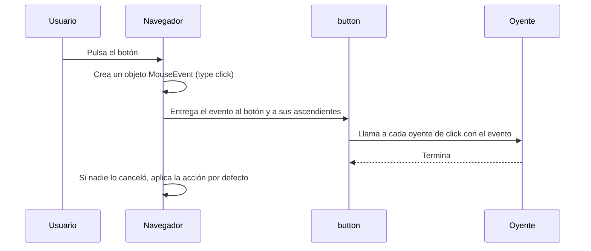
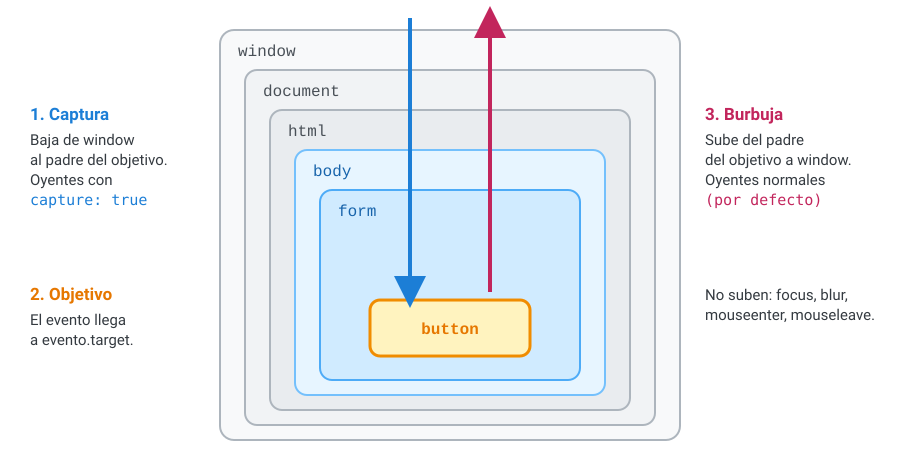
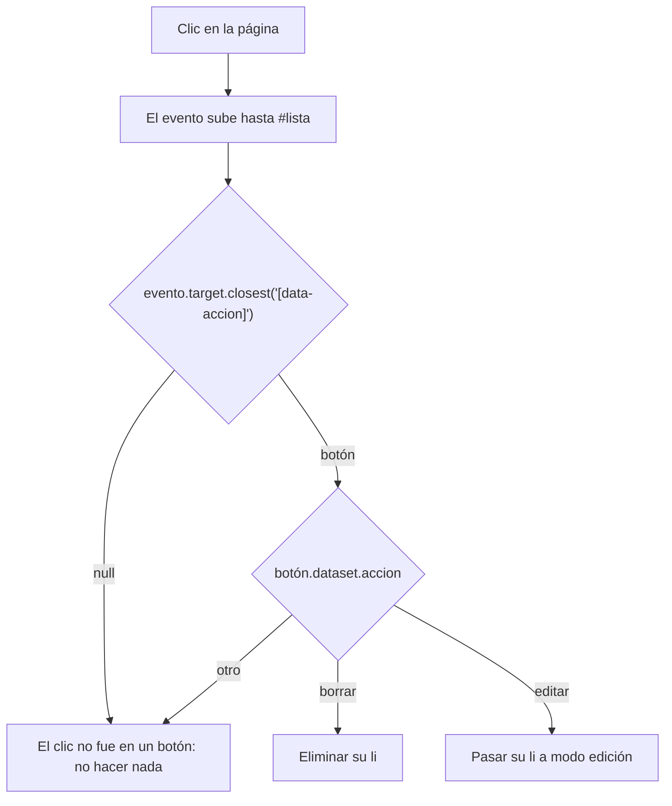

# 2. El modelo de eventos

[⬅️ Volver a la unidad](./README.md)

## Índice

- [2.1. Eventos, oyentes y el patrón Observer](#21-eventos-oyentes-y-el-patrón-observer)
- [2.2. `addEventListener` y sus opciones](#22-addeventlistener-y-sus-opciones)
  - [2.2.1. Quitar oyentes: `removeEventListener`](#221-quitar-oyentes-removeeventlistener)
  - [2.2.2. Quitar varios de golpe: `signal`](#222-quitar-varios-de-golpe-signal)
  - [2.2.3. `once` y `passive`](#223-once-y-passive)
- [2.3. El objeto `Event`](#23-el-objeto-event)
  - [2.3.1. Cancelar la acción por defecto](#231-cancelar-la-acción-por-defecto)
- [2.4. La propagación: captura y burbuja](#24-la-propagación-captura-y-burbuja)
  - [2.4.1. Las tres fases](#241-las-tres-fases)
  - [2.4.2. Escuchar en la fase de captura](#242-escuchar-en-la-fase-de-captura)
  - [2.4.3. Detener la propagación](#243-detener-la-propagación)
  - [2.4.4. Eventos que no suben](#244-eventos-que-no-suben)
- [2.5. La delegación de eventos](#25-la-delegación-de-eventos)
- [2.6. `this` en los oyentes y cómo pasarles datos](#26-this-en-los-oyentes-y-cómo-pasarles-datos)
- [2.7. Ejemplo integrador: menú desplegable](#27-ejemplo-integrador-menú-desplegable)
- [Resumen](#resumen)
- [Ejercicios de reflexión](#ejercicios-de-reflexión)

> **CE que trabaja este tema:** RA5 b.

---

## 2.1. Eventos, oyentes y el patrón Observer

Un **evento** es un objeto que el navegador crea cuando ocurre algo y que **entrega** a los nodos que se han suscrito. La suscripción es una función, el **oyente** o **manejador** (*event listener*, *event handler*).

Es el patrón **Observer** de la UD3: cada nodo es un **sujeto** (hereda de `EventTarget`, UD5) con su lista de observadores por tipo de evento.



El diagrama muestra el **ciclo de un evento**: el navegador lo crea, recorre el árbol llamando a los oyentes y, al final, aplica la acción por defecto si ningún oyente la ha cancelado.

> 📝 **Nota del Profesor**: JavaScript en el navegador es **dirigido por eventos** (*event-driven*): tu código se ejecuta al cargar la página, registra oyentes y termina. A partir de ahí, solo se ejecuta cuando llega un evento. El bucle de eventos (UD1 y UD7) es quien los saca de la cola de uno en uno, así que **un oyente lento bloquea la página**.

---

## 2.2. `addEventListener` y sus opciones

```js
destino.addEventListener(tipo, oyente, opciones);
```

| Parámetro | Qué es |
|-----------|--------|
| `tipo` | Nombre del evento sin `on`: `'click'`, `'keydown'`, `'submit'` |
| `oyente` | Una función que recibe el evento (o un objeto con un método `handleEvent`, apartado 2.6) |
| `opciones` | Un objeto (o `true`/`false`, que equivale a `{ capture }`) |

| Opción | Valor por defecto | Qué hace |
|--------|:-----------------:|----------|
| `capture` | `false` | Escucha en la fase de **captura** en vez de en la de burbuja (apartado 2.4) |
| `once` | `false` | El oyente se quita solo después de ejecutarse una vez |
| `passive` | `false` | Promete que el oyente **no** llamará a `preventDefault()`; el navegador puede desplazar la página sin esperarle |
| `signal` | — | Un `AbortSignal`: al abortarlo, se quita el oyente |

Tres reglas del registro:

- Un elemento admite **varios oyentes** del mismo tipo; se ejecutan en el **orden en que se registraron**.
- Registrar **la misma función** dos veces para el mismo tipo y fase **no** la duplica: se ignora.
- El oyente recibe siempre el objeto evento como primer parámetro.

```js
const boton = document.querySelector('#guardar');
function avisar() { console.log('📢 Aviso'); }

boton.addEventListener('click', () => console.log('1️⃣ Guardar'));
boton.addEventListener('click', avisar);
boton.addEventListener('click', avisar); // ignorado: misma función
boton.addEventListener('click', () => console.log('2️⃣ Registrar'));
// Salida al pulsar:
// 1️⃣ Guardar
// 📢 Aviso
// 2️⃣ Registrar
```

### 2.2.1. Quitar oyentes: `removeEventListener`

`removeEventListener` necesita **la misma referencia** de función (y la misma fase de captura):

```js
function alPulsar() { console.log('Pulsado'); }
boton.addEventListener('click', alPulsar);
boton.removeEventListener('click', alPulsar);     // ✅ quitado

boton.addEventListener('click', () => console.log('Hola'));
boton.removeEventListener('click', () => console.log('Hola')); // ❌ otra función: no quita nada

boton.addEventListener('click', alPulsar, { capture: true });
boton.removeEventListener('click', alPulsar);     // ❌ no lo quita: falta capture: true
```

### 2.2.2. Quitar varios de golpe: `signal`

Cuando un componente registra muchos oyentes (en el elemento, en `document`, en `window`), quitarlos uno a uno es pesado y fácil de olvidar. Con un **`AbortController`** se pasa la misma señal a todos y se quitan con una sola llamada:

```js
const controlador = new AbortController();
const { signal } = controlador;

boton.addEventListener('click', guardar, { signal });
document.addEventListener('keydown', atajos, { signal });
window.addEventListener('resize', recolocar, { signal });

// Más tarde, al cerrar el componente:
controlador.abort(); // los tres oyentes desaparecen
```

> ✅ **Buena práctica**: Si un componente se puede **destruir** (un diálogo, un carrusel, una vista que se sustituye), registra sus oyentes con un `signal` y ofrece un método `destruir()` que llame a `abort()`. Así no se quedan oyentes vivos sobre elementos que ya no se usan (una **fuga de memoria**).

### 2.2.3. `once` y `passive`

```js
// Solo la primera vez: un mensaje de bienvenida
document.querySelector('#ayuda').addEventListener('click', mostrarBienvenida, { once: true });

// Desplazamiento fluido: el navegador no espera al oyente para desplazar
window.addEventListener('wheel', registrarRueda, { passive: true });
```

Los navegadores ya tratan como pasivos por defecto los oyentes de `wheel`, `touchstart` y `touchmove` registrados en `window`, `document` o `body`. Si dentro llamas a `preventDefault()`, se ignora y la consola muestra un aviso.

---

## 2.3. El objeto `Event`

Todos los eventos heredan de `Event`. Cada tipo añade lo suyo: `MouseEvent` (coordenadas, botón), `KeyboardEvent` (tecla), `InputEvent`, `SubmitEvent`… (tema 3).

| Propiedad | Qué es |
|-----------|--------|
| `type` | El tipo: `'click'` |
| `target` | El nodo **donde ocurrió** (el más interno) |
| `currentTarget` | El nodo **cuyo oyente se está ejecutando** ahora |
| `eventPhase` | `1` captura, `2` en el objetivo, `3` burbuja |
| `bubbles` | Si el evento sube (apartado 2.4.4) |
| `cancelable` | Si se puede cancelar su acción por defecto |
| `defaultPrevented` | Si algún oyente ya llamó a `preventDefault()` |
| `isTrusted` | `true` si lo generó el usuario; `false` si lo lanzó el código con `dispatchEvent` |
| `timeStamp` | Milisegundos desde que se cargó la página |

| Método | Qué hace |
|--------|----------|
| `preventDefault()` | Cancela la acción por defecto (si `cancelable`) |
| `stopPropagation()` | Impide que el evento siga a otros nodos |
| `stopImmediatePropagation()` | Lo anterior y, además, que se ejecuten los demás oyentes del mismo nodo |
| `composedPath()` | Devuelve el camino del evento: del `target` hasta `window` |

```js
document.querySelector('#lista').addEventListener('click', (evento) => {
  console.log(evento.type, evento.target.tagName, evento.currentTarget.id, evento.eventPhase);
});
// Al pulsar un <span> dentro de un <li>: click SPAN lista 3
```

> ⚠️ **Cuidado**: `currentTarget` solo tiene valor **mientras** se ejecuta el oyente. Si guardas el evento y lo miras después (en un `setTimeout`, en la consola), `currentTarget` vale `null`. Guarda el elemento en una variable si lo necesitas más tarde.

### 2.3.1. Cancelar la acción por defecto

```js
document.querySelector('#formulario').addEventListener('submit', (evento) => {
  evento.preventDefault(); // la página no se recarga: los datos los gestiona JavaScript
  console.log('Enviado por JavaScript');
});

document.querySelector('#enlace-externo').addEventListener('click', (evento) => {
  if (!confirm('Vas a salir de la página. ¿Continuar?')) evento.preventDefault();
});
```

`preventDefault()` **no** detiene la propagación: los demás oyentes siguen ejecutándose y pueden consultar `evento.defaultPrevented`. Y `stopPropagation()` **no** cancela la acción por defecto. Son dos cosas distintas.

> 💡 **Tip del Examinador**: "¿Qué diferencia hay entre `preventDefault()` y `stopPropagation()`?" → `preventDefault()` cancela lo que haría el navegador (enviar, navegar, marcar); `stopPropagation()` impide que el evento llegue a otros nodos del camino. Uno no implica el otro.

---

## 2.4. La propagación: captura y burbuja

### 2.4.1. Las tres fases

Un clic en un botón que está dentro de un formulario, dentro de `<body>`, ocurre **también** en todos sus ascendientes. Cuando los navegadores empezaron a programarse, Netscape decidió que el evento llegara primero al elemento más externo (**captura**) y Microsoft, al más interno (**burbuja**). El W3C unificó los dos modelos y el estándar actual del WHATWG los mantiene: el evento recorre el árbol en **tres fases**.



| Fase | `eventPhase` | Recorrido | Quién escucha |
|------|:------------:|-----------|---------------|
| 1. **Captura** | 1 | De `window` hacia abajo, hasta el padre del objetivo | Los oyentes registrados con `capture: true` |
| 2. **Objetivo** | 2 | El propio `target` | Todos sus oyentes: primero los de captura y después los demás |
| 3. **Burbuja** | 3 | Del padre del objetivo hacia arriba, hasta `window` | Los oyentes normales (`capture: false`) |

La imagen muestra que un mismo clic **pasa dos veces** por cada ascendiente: al bajar y al subir. Que un oyente se ejecute en una u otra vuelta depende de la opción `capture`.

```html
<div id="exterior">
  <p id="medio">
    <button id="interior">Pulsar</button>
  </p>
</div>
```

```js
for (const id of ['exterior', 'medio', 'interior']) {
  const elemento = document.getElementById(id);
  elemento.addEventListener('click', () => console.log(`⬇️ captura: ${id}`), { capture: true });
  elemento.addEventListener('click', () => console.log(`⬆️ burbuja: ${id}`));
}
// Salida al pulsar el botón:
// ⬇️ captura: exterior
// ⬇️ captura: medio
// ⬇️ captura: interior
// ⬆️ burbuja: interior
// ⬆️ burbuja: medio
// ⬆️ burbuja: exterior
```

En el botón (fase de objetivo) se ejecutan sus dos oyentes, primero el de captura y después el de burbuja, aunque los dos tienen `eventPhase` 2.

> 📝 **Nota del Profesor**: Hasta 2021, en la fase de objetivo los oyentes se ejecutaban en el orden de registro, sin importar `capture`. El estándar cambió y los navegadores actuales ejecutan primero los de captura. Si lees material antiguo, puede decir lo contrario.

### 2.4.2. Escuchar en la fase de captura

Casi siempre se escucha en la burbuja (el valor por defecto). La captura sirve cuando un contenedor necesita enterarse **antes** que los hijos, por ejemplo para registrar todos los clics de la página aunque algún hijo detenga la propagación:

```js
document.addEventListener('click', (evento) => {
  console.log('Clic en', evento.target.tagName);
}, { capture: true }); // se ejecuta antes que cualquier oyente de burbuja
```

### 2.4.3. Detener la propagación

```js
document.querySelector('#interior').addEventListener('click', (evento) => {
  evento.stopPropagation(); // exterior y medio ya no reciben el clic en la burbuja
});
```

> ⚠️ **Cuidado**: Detener la propagación «por si acaso» rompe otras partes de la página que dependen de ella: un menú que se cierra al pulsar fuera, una analítica que cuenta clics, una delegación en un contenedor. Úsala solo cuando sepas qué oyente concreto quieres evitar, y prefiere comprobar `evento.target` en el oyente del contenedor.

### 2.4.4. Eventos que no suben

No todos los eventos burbujean. Si `evento.bubbles` es `false`, el evento pasa por la captura y llega al objetivo, pero no vuelve a subir.

| No suben | Alternativa que sí sube |
|----------|-------------------------|
| `focus`, `blur` | `focusin`, `focusout` |
| `mouseenter`, `mouseleave` | `mouseover`, `mouseout` |
| `load`, `error` de una imagen o un script | Escuchar en la fase de captura de un ascendiente |
| `scroll` de un elemento (sí sube en `document`) | Escucharlo en el propio elemento |

```js
// ❌ No funciona: focus no sube hasta el formulario
formulario.addEventListener('focus', marcarCampo);

// ✅ focusin sí sube
formulario.addEventListener('focusin', (evento) => evento.target.classList.add('activo'));
formulario.addEventListener('focusout', (evento) => evento.target.classList.remove('activo'));
```

---

## 2.5. La delegación de eventos

La **delegación** registra **un único oyente** en un contenedor y, con `evento.target`, averigua sobre qué hijo se actuó. Funciona gracias a la burbuja: el evento de cualquier hijo llega al contenedor.



El diagrama resume la receta: subir desde el `target` hasta el elemento que interesa con `closest`, descartar los clics que no son de ningún botón y decidir la acción con un atributo `data-*`.

```js
document.querySelector('#lista').addEventListener('click', (evento) => {
  const boton = evento.target.closest('[data-accion]');
  if (!boton || !evento.currentTarget.contains(boton)) return;
  const elemento = boton.closest('li');
  if (boton.dataset.accion === 'borrar') elemento.remove();
  if (boton.dataset.accion === 'editar') elemento.classList.add('editando');
});
```

| Ventaja | Por qué |
|---------|---------|
| Sirve para los elementos creados después | El oyente está en el contenedor, que ya existía |
| Menos oyentes | Uno en vez de uno por elemento: menos memoria y menos código |
| Un único sitio para la lógica | Las acciones se ven juntas |

> 💡 **Tip del Examinador**: "¿Por qué se usa `closest` y no directamente `evento.target`?" → Porque el `target` es el elemento más interno: si el botón contiene un icono o un `<span>`, el `target` es ese icono. `closest` sube desde el `target` hasta el primer elemento que encaja con el selector.

> ⚠️ **Cuidado**: La comprobación `evento.currentTarget.contains(boton)` evita un error sutil: si el contenedor está dentro de otro elemento con `data-accion`, `closest` podría encontrar ese elemento **de fuera**. En listas sencillas no pasa, pero en componentes anidados sí.

---

## 2.6. `this` en los oyentes y cómo pasarles datos

| Oyente | `this` vale |
|--------|-------------|
| `function (evento) { … }` | `evento.currentTarget` |
| `(evento) => { … }` | El `this` de fuera (UD3): en un módulo, `undefined`; en un método de clase, la instancia |
| Objeto con `handleEvent` | El propio objeto |

Lo más claro es **no depender de `this`** para el elemento y usar `evento.currentTarget`. En las clases, las flechas son útiles precisamente porque mantienen la instancia:

```js
class Contador {
  #valor = 0;

  constructor(boton) {
    this.boton = boton;
    // ✅ flecha: this es la instancia
    boton.addEventListener('click', () => this.incrementar());
    // ❌ boton.addEventListener('click', this.incrementar): this sería el botón
  }

  incrementar() {
    this.#valor++;
    this.boton.textContent = `Pulsado ${this.#valor} veces`;
  }
}
```

Para **pasar datos** a un oyente, se usa un **closure** (UD3): una flecha que llama a la función con los datos que necesita.

```js
for (const producto of productos) {
  const boton = crearBoton(producto);
  boton.addEventListener('click', () => anadirAlCarrito(producto.id)); // closure sobre producto
}
```

Una alternativa menos conocida es pasar un **objeto con un método `handleEvent`**: el navegador llama a ese método y `this` es el objeto. Permite un único oyente que reparte por tipo:

```js
const arrastre = {
  inicio: null,
  handleEvent(evento) {
    if (evento.type === 'pointerdown') this.inicio = evento.clientX;
    if (evento.type === 'pointerup') console.log(`Desplazado ${evento.clientX - this.inicio} px`);
  },
};
zona.addEventListener('pointerdown', arrastre);
zona.addEventListener('pointerup', arrastre);
```

---

## 2.7. Ejemplo integrador: menú desplegable

Un menú que se abre con su botón, se cierra al pulsar **fuera** o con **Escape**, y que se puede destruir quitando todos sus oyentes. Junta las opciones de registro, el objeto evento, la propagación y la delegación.

```html
<nav class="menu" id="menu-usuario">
  <button type="button" class="menu-boton" aria-expanded="false" aria-controls="menu-opciones">Mi cuenta</button>
  <ul id="menu-opciones" hidden>
    <li><button type="button" data-accion="perfil">Perfil</button></li>
    <li><button type="button" data-accion="salir">Cerrar sesión</button></li>
  </ul>
</nav>
```

```js
// menu.js
/**
 * Inicia un menú desplegable.
 * @param {HTMLElement} menu Contenedor con un `.menu-boton` y una lista de opciones.
 * @param {function(string): void} alElegir Recibe la acción de la opción pulsada.
 * @returns {{ destruir: function(): void }}
 */
export function iniciarMenu(menu, alElegir) {
  const boton = menu.querySelector('.menu-boton');
  const lista = menu.querySelector('ul');
  const controlador = new AbortController();
  const { signal } = controlador;

  const abrir = (abierto) => {
    boton.setAttribute('aria-expanded', String(abierto));
    lista.hidden = !abierto;
  };

  boton.addEventListener('click', () => abrir(lista.hidden), { signal });

  // Delegación: un oyente para todas las opciones
  lista.addEventListener('click', (evento) => {
    const opcion = evento.target.closest('[data-accion]');
    if (!opcion) return;
    abrir(false);
    alElegir(opcion.dataset.accion);
  }, { signal });

  // Clic fuera: el evento sube hasta document; si no viene del menú, se cierra
  document.addEventListener('click', (evento) => {
    if (!menu.contains(evento.target)) abrir(false);
  }, { signal });

  document.addEventListener('keydown', (evento) => {
    if (evento.key === 'Escape' && !lista.hidden) {
      abrir(false);
      boton.focus();
    }
  }, { signal });

  return { destruir: () => controlador.abort() };
}
```

```js
// main.js
import { iniciarMenu } from './menu.js';

const menu = iniciarMenu(document.querySelector('#menu-usuario'), (accion) => {
  console.log(`📢 Opción elegida: ${accion}`);
});
// Si la vista se sustituye: menu.destruir();
```

| Técnica | Dónde |
|---------|-------|
| `signal` para quitar todos los oyentes | `AbortController` y `destruir()` |
| Burbuja hasta `document` | Cerrar al pulsar fuera |
| `contains` en vez de `stopPropagation` | El menú no corta la propagación a nadie |
| Delegación | Un oyente para todas las opciones |
| Datos al oyente | El callback `alElegir` (closure) |
| Estado en atributos | `aria-expanded` y `hidden` |

---

## Resumen

- Los eventos siguen el patrón **Observer**: los nodos (`EventTarget`) avisan a sus oyentes.
- `addEventListener(tipo, oyente, opciones)`: varios oyentes en orden de registro; la misma función no se duplica. Opciones: `capture`, `once`, `passive` y `signal`.
- `removeEventListener` necesita la misma función y la misma fase; con `signal` y `AbortController.abort()` se quitan muchos de golpe.
- El objeto evento: `type`, `target`, `currentTarget`, `eventPhase`, `bubbles`, `cancelable`, `isTrusted`; `preventDefault()`, `stopPropagation()`, `stopImmediatePropagation()`.
- La **propagación** tiene tres fases: **captura** (baja), **objetivo** y **burbuja** (sube). Por defecto se escucha en la burbuja.
- `focus`, `blur`, `mouseenter` y `mouseleave` no suben: usa `focusin`, `focusout`, `mouseover` y `mouseout`.
- La **delegación** usa un oyente en el contenedor, `closest` y atributos `data-*`; funciona con los elementos creados después.
- Usa `evento.currentTarget` en vez de `this`; en las clases, flechas para mantener la instancia; para pasar datos, closures.

## Ejercicios de reflexión

1. Registra un oyente de captura y otro de burbuja en `document`, en un `<div>` y en un botón dentro. Antes de pulsar, escribe el orden en que crees que se ejecutarán. ¿Acertaste?
2. ¿Qué pasa si llamas a `stopPropagation()` en el oyente de captura de `document`? ¿Llega el clic al botón?
3. ¿Por qué `removeEventListener('click', () => {…})` nunca quita nada? ¿Qué dos formas tienes de quitar ese oyente?
4. Tienes una tabla de 500 filas con un botón «Borrar» en cada una. Compara asociar un oyente por botón con la delegación: número de oyentes, filas añadidas después y dónde está el código.
5. Explica por qué `formulario.addEventListener('focus', …)` no se ejecuta al entrar en un campo y cómo lo arreglas.

---

[⬅️ Volver a la unidad](./README.md)
