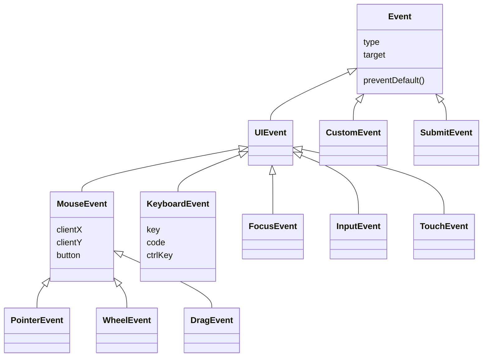
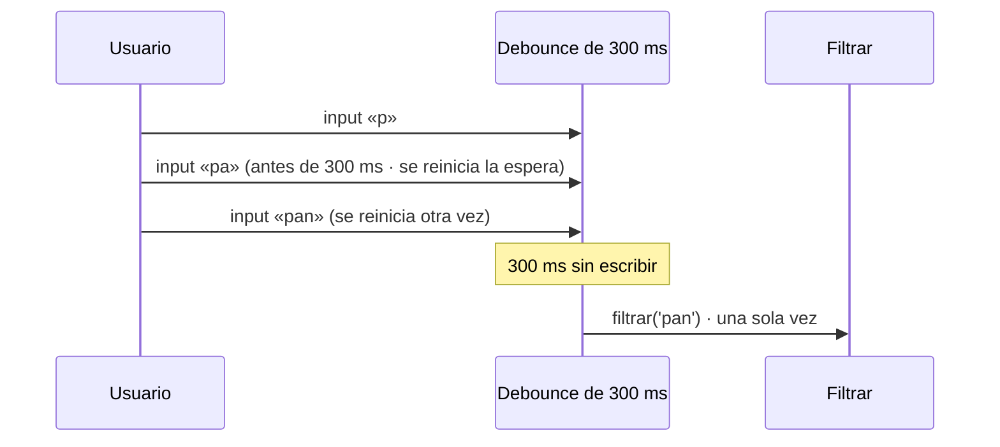

# 3. Tipos de eventos

[⬅️ Volver a la unidad](./README.md)

## Índice

- [3.1. Familias de eventos](#31-familias-de-eventos)
- [3.2. Ratón](#32-ratón)
- [3.3. Puntero y táctiles](#33-puntero-y-táctiles)
- [3.4. Teclado](#34-teclado)
- [3.5. Foco](#35-foco)
- [3.6. Formulario](#36-formulario)
- [3.7. Ventana y documento](#37-ventana-y-documento)
- [3.8. Portapapeles](#38-portapapeles)
- [3.9. Arrastrar y soltar](#39-arrastrar-y-soltar)
- [3.10. Eventos propios: `CustomEvent`](#310-eventos-propios-customevent)
- [3.11. Eventos muy frecuentes: _debounce_ y _throttle_](#311-eventos-muy-frecuentes-debounce-y-throttle)
- [3.12. Ejemplo integrador: bloc de notas](#312-ejemplo-integrador-bloc-de-notas)
- [Resumen](#resumen)
- [Ejercicios de reflexión](#ejercicios-de-reflexión)

> **CE que trabaja este tema:** RA5 c, d.

---

## 3.1. Familias de eventos

Hay cientos de tipos de eventos. No se trata de memorizarlos, sino de saber **qué familias existen**, qué **interfaz** usa cada una (qué propiedades trae el objeto evento) y dónde consultarlas: la página «Event reference» de MDN.

| Familia | Ejemplos | Interfaz del objeto evento |
|---------|----------|----------------------------|
| Ratón | `click`, `dblclick`, `contextmenu`, `mousemove` | `MouseEvent` |
| Puntero | `pointerdown`, `pointermove`, `pointerup` | `PointerEvent` (hereda de `MouseEvent`) |
| Táctiles | `touchstart`, `touchmove`, `touchend` | `TouchEvent` |
| Rueda | `wheel` | `WheelEvent` |
| Teclado | `keydown`, `keyup` | `KeyboardEvent` |
| Foco | `focus`, `blur`, `focusin`, `focusout` | `FocusEvent` |
| Formulario | `input`, `change`, `submit`, `reset`, `invalid` | `InputEvent`, `SubmitEvent`, `Event` |
| Ventana y documento | `load`, `DOMContentLoaded`, `resize`, `scroll`, `visibilitychange` | `Event`, `UIEvent` |
| Portapapeles | `copy`, `cut`, `paste` | `ClipboardEvent` |
| Arrastrar y soltar | `dragstart`, `dragover`, `drop` | `DragEvent` |
| Propios | Los que inventes tú | `CustomEvent` |



El diagrama muestra la **jerarquía de interfaces**: todas heredan de `Event`, así que todas tienen `type`, `target` y `preventDefault()`; cada una añade lo propio de su familia. Un `PointerEvent` es también un `MouseEvent`, y por eso tiene `clientX`.

> 💡 **Tip del Examinador**: "¿Cómo sabes qué propiedades tiene el evento de un oyente?" → Mirando su interfaz en MDN (`MouseEvent`, `KeyboardEvent`…) o con un `console.log(evento)` en el oyente: la consola muestra el objeto con su cadena de prototipos.

---

## 3.2. Ratón

| Evento | Cuándo | ¿Sube? |
|--------|--------|:------:|
| `mousedown`, `mouseup` | Se pulsa o se suelta un botón del ratón | ✅ |
| `click` | `mousedown` + `mouseup` sobre el mismo elemento (también con Intro o espacio en un botón) | ✅ |
| `dblclick` | Dos clics seguidos | ✅ |
| `contextmenu` | Botón derecho (o pulsación larga en móvil); su acción por defecto abre el menú | ✅ |
| `mousemove` | El puntero se mueve sobre el elemento (muchas veces por segundo) | ✅ |
| `mouseover`, `mouseout` | Entra o sale del elemento **o de un hijo** | ✅ |
| `mouseenter`, `mouseleave` | Entra o sale del elemento (ignora los hijos) | ❌ |

| Propiedad de `MouseEvent` | Qué es |
|---------------------------|--------|
| `clientX`, `clientY` | Posición respecto a la **ventana** visible |
| `pageX`, `pageY` | Posición respecto al **documento** (incluye lo desplazado) |
| `offsetX`, `offsetY` | Posición respecto al elemento `target` |
| `button` | Qué botón: `0` principal, `1` central, `2` secundario |
| `ctrlKey`, `shiftKey`, `altKey`, `metaKey` | Si había una tecla modificadora pulsada |
| `relatedTarget` | En `mouseover`/`mouseout`: el elemento del que viene o al que va |

Orden de los eventos de un doble clic: `mousedown` → `mouseup` → `click` → `mousedown` → `mouseup` → `click` → `dblclick`. Si un elemento tiene a la vez acción con `click` y con `dblclick`, la de `click` se ejecuta **dos veces** antes de la de doble clic.

```js
const zona = document.querySelector('#zona');
zona.addEventListener('mousemove', (evento) => {
  zona.textContent = `x: ${evento.offsetX} · y: ${evento.offsetY}`;
});
zona.addEventListener('contextmenu', (evento) => {
  evento.preventDefault(); // sin menú del navegador: mostramos el nuestro
  console.log(`Menú propio en ${evento.clientX}, ${evento.clientY}`);
});
```

> ⚠️ **Cuidado**: `mouseover` se lanza otra vez cada vez que el puntero pasa a un hijo, porque el evento **sube** desde el hijo. Si quieres saber solo cuándo entras y sales de la tarjeta entera, usa `mouseenter` y `mouseleave`.

---

## 3.3. Puntero y táctiles

Los **eventos de puntero** (*pointer events*) unifican ratón, dedo y lápiz en una sola familia. Son la opción recomendada para arrastrar, dibujar o deslizar, porque funcionan igual con todos los dispositivos.

| Puntero | Equivale a | Táctil |
|---------|-----------|--------|
| `pointerdown` | `mousedown` | `touchstart` |
| `pointermove` | `mousemove` | `touchmove` |
| `pointerup` | `mouseup` | `touchend` |
| `pointercancel` | — | `touchcancel` (el sistema interrumpe el gesto) |

`PointerEvent` añade `pointerId` (cada dedo tiene el suyo), `pointerType` (`'mouse'`, `'touch'` o `'pen'`) y `pressure`. Y el elemento tiene `setPointerCapture(id)`: a partir de ahí recibe todos los `pointermove` de ese puntero **aunque salga de él**, algo imprescindible al arrastrar.

```js
// Mover una nota por la pantalla con el ratón, el dedo o el lápiz
const nota = document.querySelector('.nota');
let inicio = null;

nota.addEventListener('pointerdown', (evento) => {
  inicio = { x: evento.clientX - nota.offsetLeft, y: evento.clientY - nota.offsetTop };
  nota.setPointerCapture(evento.pointerId);
  nota.classList.add('arrastrando');
});
nota.addEventListener('pointermove', (evento) => {
  if (!inicio) return;
  nota.style.left = `${evento.clientX - inicio.x}px`; // la posición es un dato calculado: aquí sí se usa style
  nota.style.top = `${evento.clientY - inicio.y}px`;
});
nota.addEventListener('pointerup', () => {
  inicio = null;
  nota.classList.remove('arrastrando');
});
```

```css
.nota { position: absolute; touch-action: none; } /* el navegador no desplaza la página al arrastrar con el dedo */
```

> 📝 **Nota del Profesor**: Cambiar el aspecto con clases y no con `style` es la regla de la UD5, pero una **posición calculada en cada movimiento** no se puede expresar con clases. En ese caso se escribe en `style` (o en una variable CSS con `style.setProperty('--x', …)`), y todo lo demás (colores, sombra al arrastrar) sigue en el CSS.

Los **eventos táctiles** (`touchstart`…) son anteriores y solo sirven para pantallas táctiles; traen la lista de dedos en `evento.touches`. Los verás en código heredado; para código nuevo, usa los de puntero.

---

## 3.4. Teclado

| Evento | Cuándo |
|--------|--------|
| `keydown` | Se pulsa una tecla. Se repite si se mantiene pulsada (`evento.repeat` vale `true`) |
| `keyup` | Se suelta |
| `keypress` | **Obsoleto**: no lo uses; usa `keydown` |

Los eventos de teclado llegan al **elemento con el foco** (y suben hasta `document`). Para atajos globales se escucha en `document`.

| Propiedad | Qué es | Pulsando la tecla «Z» en un teclado español |
|-----------|--------|---------------------------------------------|
| `key` | El **carácter** o nombre de la tecla, según la distribución del teclado | `'z'` (o `'Z'` con Mayúsculas) |
| `code` | La **tecla física**, como si el teclado fuera estadounidense | `'KeyZ'` |
| `ctrlKey`, `shiftKey`, `altKey`, `metaKey` | Modificadores pulsados (`metaKey`: tecla Cmd en Mac, Windows en PC) | `false` |
| `repeat` | Si es una repetición automática | `false` |

Nombres de `key` habituales: `'Enter'`, `'Escape'`, `'Tab'`, `' '` (espacio), `'ArrowUp'`, `'ArrowDown'`, `'ArrowLeft'`, `'ArrowRight'`, `'Home'`, `'End'`, `'Backspace'`, `'Delete'`.

```js
document.addEventListener('keydown', (evento) => {
  // Ctrl+S (o Cmd+S en Mac): guardar sin que el navegador abra «Guardar página»
  if ((evento.ctrlKey || evento.metaKey) && evento.key.toLowerCase() === 's') {
    evento.preventDefault();
    guardar();
  }
  // «?» muestra la ayuda, salvo que se esté escribiendo en un campo
  if (evento.key === '?' && !evento.target.closest('input, textarea, select, [contenteditable]')) {
    mostrarAyuda();
  }
});
```

| ¿`key` o `code`? | Usa |
|------------------|-----|
| Atajos que dependen de la **letra** (Ctrl+S de «guardar») | `key` |
| Teclas que dependen de la **posición** (WASD para moverse en un juego) | `code` |
| Teclas especiales (Escape, flechas) | `key` |

> ⚠️ **Cuidado**: Un atajo de una sola letra en `document` se dispara también mientras el usuario **escribe** en un campo. Comprueba siempre que `evento.target` no es un campo de texto. Y no captures atajos del sistema o del navegador (Ctrl+W, Ctrl+T) ni las teclas de los lectores de pantalla.

> 💡 **Tip del Examinador**: "¿Qué diferencia hay entre `key` y `code`?" → `key` es el carácter que produce la tecla según la distribución del teclado (`'z'`, `'ñ'`); `code` es la tecla física (`'KeyZ'`, `'Semicolon'`), igual en cualquier distribución.

---

## 3.5. Foco

Solo los elementos **enfocables** reciben el foco: enlaces, botones, campos de formulario y cualquier elemento con `tabindex`.

| Evento | Cuándo | ¿Sube? |
|--------|--------|:------:|
| `focus` | El elemento recibe el foco | ❌ |
| `blur` | El elemento pierde el foco | ❌ |
| `focusin` | Como `focus`, pero sube | ✅ |
| `focusout` | Como `blur`, pero sube | ✅ |

`FocusEvent.relatedTarget` es el elemento que pierde (en `focus`) o gana (en `blur`) el foco, o `null`. Sirve, por ejemplo, para cerrar un panel solo cuando el foco sale **fuera** de él:

```js
panel.addEventListener('focusout', (evento) => {
  if (!panel.contains(evento.relatedTarget)) cerrarPanel(); // el foco se ha ido fuera del panel
});
```

Desde el código: `elemento.focus()`, `elemento.blur()` y `document.activeElement` (el que tiene el foco ahora).

---

## 3.6. Formulario

| Evento | Cuándo | Lo verás en |
|--------|--------|-------------|
| `input` | Cada vez que cambia el valor (cada tecla, pegar, autocompletar) | Tema 4 |
| `change` | El valor cambia y se **confirma**: al salir del campo de texto, al marcar una casilla, al elegir en un `<select>` | Tema 4 |
| `beforeinput` | Justo antes de que cambie el valor; se puede cancelar | — |
| `submit` | Se envía el formulario (botón de envío o Intro en un campo) | Temas 4 y 5 |
| `reset` | Se restablece el formulario | Tema 4 |
| `invalid` | Un campo no supera la validación al intentar enviar o al llamar a `checkValidity()` | Tema 5 |
| `select` | Se selecciona texto dentro de un campo | — |

```js
const campo = document.querySelector('#nombre');
campo.addEventListener('input', () => console.log('input:', campo.value));
campo.addEventListener('change', () => console.log('change:', campo.value));
// Escribiendo «Ana» y saliendo del campo:
// input: A
// input: An
// input: Ana
// change: Ana
```

---

## 3.7. Ventana y documento

| Evento | Sobre | Cuándo |
|--------|-------|--------|
| `DOMContentLoaded` | `document` | El DOM está construido (UD5) |
| `load` | `window` | Ha cargado todo, imágenes incluidas |
| `resize` | `window` | Cambia el tamaño de la ventana (muchas veces seguidas) |
| `scroll` | `window` o un elemento | Se desplaza el contenido (muchas veces seguidas) |
| `visibilitychange` | `document` | La pestaña pasa a segundo plano o vuelve (`document.visibilityState`: `'hidden'` o `'visible'`) |
| `beforeunload` | `window` | El usuario va a salir de la página |
| `online`, `offline` | `window` | Se pierde o se recupera la conexión |
| `hashchange`, `popstate` | `window` | Cambia el fragmento `#` o se navega por el historial (UD4) |

```js
// Pausar una animación o un temporizador cuando la pestaña no se ve
document.addEventListener('visibilitychange', () => {
  if (document.visibilityState === 'hidden') pausar();
  else reanudar();
});

// Avisar antes de salir si hay cambios sin guardar
addEventListener('beforeunload', (evento) => {
  if (hayCambios) evento.preventDefault(); // el navegador muestra su propio aviso
});
```

> ✅ **Buena práctica**: Para **reaccionar al tamaño** de un elemento, `matchMedia` (UD4) y `ResizeObserver` suelen ser mejores que `resize`; y para saber si un elemento **está a la vista**, `IntersectionObserver` es mejor que `scroll`. Se lanzan solo cuando hace falta, no decenas de veces por segundo.

---

## 3.8. Portapapeles

Los eventos `copy`, `cut` y `paste` se lanzan al copiar, cortar o pegar, y traen `evento.clipboardData` con el contenido.

```js
// Pegar solo texto plano y sin espacios sobrantes
campo.addEventListener('paste', (evento) => {
  evento.preventDefault();
  const texto = evento.clipboardData.getData('text/plain').trim();
  campo.setRangeText(texto, campo.selectionStart, campo.selectionEnd, 'end');
});
```

Para copiar desde un botón se usa la API asíncrona `navigator.clipboard.writeText` que viste en la UD4.

---

## 3.9. Arrastrar y soltar

La API de **arrastrar y soltar** (*drag and drop*) del HTML permite arrastrar elementos con `draggable="true"`, y también **ficheros** desde el escritorio.

| Evento | Sobre | Para qué |
|--------|-------|----------|
| `dragstart` | El elemento arrastrado | Guardar qué se arrastra en `evento.dataTransfer` |
| `dragenter`, `dragleave` | La zona de destino | Resaltar la zona |
| `dragover` | La zona de destino (muchas veces) | **Llamar a `preventDefault()`** para permitir soltar |
| `drop` | La zona de destino | Leer `dataTransfer` y actuar |
| `dragend` | El elemento arrastrado | Limpiar el estado |

```js
// Zona para soltar ficheros
const zona = document.querySelector('#zona-ficheros');

zona.addEventListener('dragover', (evento) => {
  evento.preventDefault(); // sin esto, el drop no se produce y el navegador abre el fichero
  zona.classList.add('encima');
});
zona.addEventListener('dragleave', () => zona.classList.remove('encima'));
zona.addEventListener('drop', (evento) => {
  evento.preventDefault();
  zona.classList.remove('encima');
  for (const fichero of evento.dataTransfer.files) {
    console.log(`📄 ${fichero.name} · ${fichero.size} bytes · ${fichero.type || 'tipo desconocido'}`);
  }
});
```

> ⚠️ **Cuidado**: La API de arrastrar y soltar del HTML **no funciona con el dedo** en muchos navegadores móviles y no se puede usar con el teclado. Ofrece siempre una alternativa: un `<input type="file">` para los ficheros o unos botones para mover elementos. Para arrastrar elementos dentro de la página en cualquier dispositivo, los eventos de puntero (apartado 3.3) son más fiables.

---

## 3.10. Eventos propios: `CustomEvent`

Un componente puede **emitir sus propios eventos** para avisar al resto de la página, sin saber quién escucha. Es el patrón Observer de la UD3 con la infraestructura del navegador.

```js
// El componente emite
const evento = new CustomEvent('carritoactualizado', {
  detail: { unidades: 3, total: 59.85 }, // los datos del evento
  bubbles: true,                          // que suba, para poder escucharlo en document
});
carrito.dispatchEvent(evento);
```

```js
// Cualquier otra parte escucha
document.addEventListener('carritoactualizado', (evento) => {
  document.querySelector('#contador').textContent = evento.detail.unidades;
});
```

| Opción | Por defecto | Para qué |
|--------|:-----------:|----------|
| `detail` | `null` | Los datos que acompañan al evento |
| `bubbles` | `false` | Si sube por el árbol |
| `cancelable` | `false` | Si los oyentes pueden llamar a `preventDefault()`; `dispatchEvent` devuelve `false` si alguno lo hizo |

Con `cancelable` un componente puede **preguntar** antes de actuar:

```js
const seguir = panel.dispatchEvent(new CustomEvent('antesdecerrar', { cancelable: true }));
if (seguir) cerrar(); // si algún oyente llamó a preventDefault(), no se cierra
```

> ✅ **Buena práctica**: Nombra los eventos propios en minúsculas y sin guiones raros (`carritoactualizado`, `pestanacambiada`), igual que los nativos, y documenta en el JSDoc del componente qué eventos emite y qué lleva su `detail` (tema 7).

`dispatchEvent` también sirve para lanzar eventos **nativos** desde el código, por ejemplo en los tests (tema 7): `campo.dispatchEvent(new Event('input', { bubbles: true }))`. Estos eventos tienen `isTrusted` a `false` y **no** ejecutan la acción por defecto de verdad: un `click` lanzado así sobre un enlace no navega.

---

## 3.11. Eventos muy frecuentes: _debounce_ y _throttle_

`input`, `scroll`, `resize`, `mousemove` y `pointermove` se lanzan **decenas de veces por segundo**. Si cada oyente hace algo costoso (filtrar mil productos, recalcular la página, más adelante pedir datos al servidor), la página se ralentiza. Dos técnicas lo resuelven:

| Técnica | Idea | Caso típico |
|---------|------|-------------|
| **_Debounce_** (rebote) | Esperar a que el usuario **pare** un tiempo y ejecutar **una vez** al final | Buscador: filtrar cuando deja de escribir 300 ms |
| **_Throttle_** (limitación) | Ejecutar **como mucho una vez** cada cierto tiempo mientras dura | Barra de progreso de lectura al desplazar: actualizar cada 100 ms |



El diagrama muestra el _debounce_: cada evento reinicia la cuenta atrás, y la función solo se ejecuta cuando pasan 300 ms **sin** eventos nuevos.

```js
// tiempo.js
/**
 * Devuelve una versión de `funcion` que solo se ejecuta cuando han pasado `espera` ms sin llamadas.
 * @param {function(...*): void} funcion
 * @param {number} espera Milisegundos.
 * @returns {function(...*): void}
 */
export function debounce(funcion, espera) {
  let temporizador;
  return (...argumentos) => {
    clearTimeout(temporizador);
    temporizador = setTimeout(() => funcion(...argumentos), espera);
  };
}

/**
 * Devuelve una versión de `funcion` que se ejecuta como mucho una vez cada `intervalo` ms.
 * @param {function(...*): void} funcion
 * @param {number} intervalo Milisegundos.
 * @returns {function(...*): void}
 */
export function throttle(funcion, intervalo) {
  let ultima = -Infinity;
  return (...argumentos) => {
    const ahora = Date.now();
    if (ahora - ultima >= intervalo) {
      ultima = ahora;
      funcion(...argumentos);
    }
  };
}
```

```js
import { debounce, throttle } from './tiempo.js';

buscador.addEventListener('input', debounce(() => filtrar(buscador.value), 300));
addEventListener('scroll', throttle(actualizarProgreso, 100), { passive: true });
```

Las dos funciones son **closures** (UD3) y funciones de orden superior: reciben una función y devuelven otra que guarda su estado (`temporizador`, `ultima`).

> 📝 **Nota del Profesor**: Este _throttle_ es la versión más sencilla: ejecuta la primera llamada de cada intervalo y descarta las demás, así que la **última** posición del desplazamiento puede perderse. Las versiones de las librerías añaden una llamada final. En la UD7 verás que el _debounce_ es imprescindible en un buscador que pide datos al servidor: sin él, cada tecla sería una petición.

> 💡 **Tip del Examinador**: "¿Debounce o throttle para un buscador que filtra al escribir?" → _Debounce_: interesa filtrar cuando el usuario **termina** de escribir, no mientras escribe. Para algo que debe actualizarse **durante** el desplazamiento, _throttle_.

---

## 3.12. Ejemplo integrador: bloc de notas

Un bloc de notas que guarda solo, cuenta palabras, guarda también con Ctrl+S, limpia lo que se pega y avisa al salir si hay cambios sin guardar.

```html
<label for="nota">Nota</label>
<textarea id="nota"></textarea>
<p id="estado" role="status"></p>
```

```js
// bloc.js (módulo)
import { debounce } from './tiempo.js';

const nota = document.querySelector('#nota');
const estado = document.querySelector('#estado');
let cambiosSinGuardar = false;

nota.value = localStorage.getItem('nota') ?? ''; // UD4

function guardar() {
  localStorage.setItem('nota', nota.value);
  cambiosSinGuardar = false;
  estado.textContent = `✅ Guardado · ${contarPalabras(nota.value)} palabras`;
}

function contarPalabras(texto) {
  return texto.trim() === '' ? 0 : texto.trim().split(/\s+/).length; // expresión regular: tema 6
}

const guardarAlParar = debounce(guardar, 1000);

nota.addEventListener('input', () => {                 // formulario
  cambiosSinGuardar = true;
  estado.textContent = '✏️ Escribiendo…';
  guardarAlParar();
});

nota.addEventListener('paste', (evento) => {           // portapapeles
  evento.preventDefault();
  const texto = evento.clipboardData.getData('text/plain').replace(/[ \t]+/g, ' ');
  nota.setRangeText(texto, nota.selectionStart, nota.selectionEnd, 'end');
  nota.dispatchEvent(new Event('input'));              // que cuente como escrito
});

document.addEventListener('keydown', (evento) => {     // teclado
  if ((evento.ctrlKey || evento.metaKey) && evento.key.toLowerCase() === 's') {
    evento.preventDefault();
    guardar();
  }
});

nota.addEventListener('blur', () => {                  // foco
  if (cambiosSinGuardar) guardar();
});

addEventListener('beforeunload', (evento) => {         // ventana
  if (cambiosSinGuardar) evento.preventDefault();
});
```

| Familia | Evento | Para qué |
|---------|--------|----------|
| Formulario | `input` | Marcar cambios y programar el guardado |
| Portapapeles | `paste` | Limpiar el texto pegado |
| Teclado | `keydown` en `document` | Ctrl+S / Cmd+S |
| Foco | `blur` | Guardar al salir del campo |
| Ventana | `beforeunload` | Avisar si hay cambios sin guardar |
| Técnica | `debounce` | Guardar un segundo después de dejar de escribir |
| Evento lanzado por código | `dispatchEvent(new Event('input'))` | Reutilizar la lógica de `input` al pegar |

---

## Resumen

- Los eventos se agrupan en **familias** con su interfaz: `MouseEvent`, `PointerEvent`, `KeyboardEvent`, `FocusEvent`, `InputEvent`, `SubmitEvent`, `DragEvent`, `ClipboardEvent`… Todas heredan de `Event`.
- **Ratón**: `click`, `dblclick`, `contextmenu`, `mousemove`; `mouseover`/`mouseout` suben y se repiten con los hijos, `mouseenter`/`mouseleave` no.
- **Puntero**: una familia para ratón, dedo y lápiz; `setPointerCapture` para arrastrar y `touch-action: none` en el CSS.
- **Teclado**: `keydown` (no `keypress`); `key` es el carácter y `code` la tecla física; modificadores `ctrlKey`, `metaKey`…; no dispares atajos mientras se escribe en un campo.
- **Foco**: `focus`/`blur` no suben; `focusin`/`focusout` sí; `relatedTarget`.
- **Formulario**: `input` (cada cambio), `change` (al confirmar), `submit`, `reset`, `invalid`.
- **Ventana**: `load`, `resize`, `scroll`, `visibilitychange`, `beforeunload`.
- **Arrastrar y soltar**: `preventDefault()` en `dragover` para permitir el `drop`; `dataTransfer.files` para ficheros; ofrece alternativa.
- **`CustomEvent`** con `detail`, `bubbles` y `cancelable` para que los componentes avisen; `dispatchEvent` lanza eventos (con `isTrusted` a `false`).
- **_Debounce_** ejecuta al final de una ráfaga; **_throttle_**, como mucho una vez por intervalo.

## Ejercicios de reflexión

1. Escribe un oyente de `keydown` que muestre `key` y `code`. Pulsa la «ñ», la «Z» con y sin Mayúsculas, y las flechas. ¿Qué cambia en cada una?
2. ¿Por qué un menú contextual propio necesita `preventDefault()` en `contextmenu`?
3. Pon `mouseover` y `mouseenter` en una tarjeta con tres hijos y mueve el ratón por dentro. ¿Cuántas veces se lanza cada uno?
4. ¿Qué pasa si olvidas `preventDefault()` en `dragover` al soltar un fichero en una zona?
5. Un buscador filtra 5 000 productos en cada `input`. Explica qué cambia al añadir un _debounce_ de 300 ms si el usuario escribe «zapatillas» de corrido.

---

[⬅️ Volver a la unidad](./README.md)
