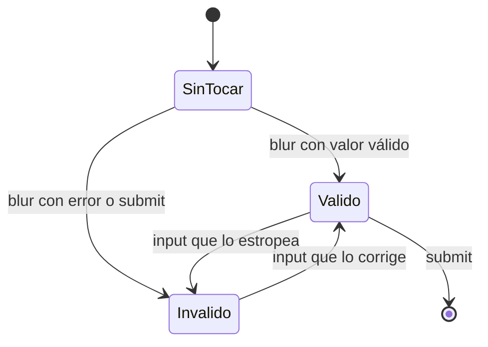
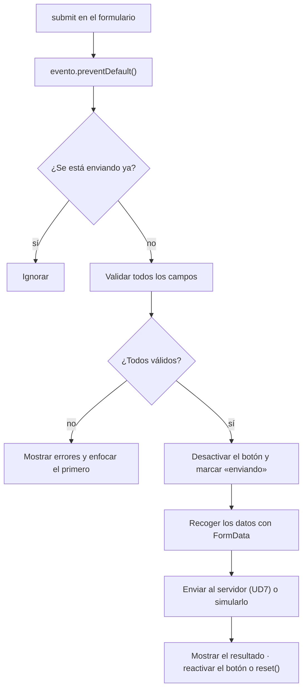

# 5. Validación y envío

[⬅️ Volver a la unidad](./README.md)

## Índice

- [5.1. Por qué validar en el cliente (y también en el servidor)](#51-por-qué-validar-en-el-cliente-y-también-en-el-servidor)
- [5.2. Validación nativa del HTML](#52-validación-nativa-del-html)
  - [5.2.1. Atributos de validación](#521-atributos-de-validación)
  - [5.2.2. Pseudoclases de validez](#522-pseudoclases-de-validez)
- [5.3. La API de validación de restricciones](#53-la-api-de-validación-de-restricciones)
  - [5.3.1. `validity`: por qué no es válido](#531-validity-por-qué-no-es-válido)
  - [5.3.2. Reglas propias con `setCustomValidity`](#532-reglas-propias-con-setcustomvalidity)
  - [5.3.3. El evento `invalid`](#533-el-evento-invalid)
- [5.4. Validar con eventos: cuándo mostrar los errores](#54-validar-con-eventos-cuándo-mostrar-los-errores)
- [5.5. Mensajes de error accesibles](#55-mensajes-de-error-accesibles)
- [5.6. El envío interceptado](#56-el-envío-interceptado)
  - [5.6.1. Evitar el doble envío](#561-evitar-el-doble-envío)
- [5.7. Ejemplo integrador: formulario de contacto](#57-ejemplo-integrador-formulario-de-contacto)
- [Resumen](#resumen)
- [Ejercicios de reflexión](#ejercicios-de-reflexión)

> **CE que trabaja este tema:** RA5 f.

---

## 5.1. Por qué validar en el cliente (y también en el servidor)

**Validar** es comprobar que los datos cumplen unas reglas antes de usarlos: que no falta el nombre, que el correo tiene forma de correo, que la edad está entre 16 y 99.

| Validación en el cliente | Validación en el servidor |
|--------------------------|---------------------------|
| Para el **usuario**: le avisa al momento, sin esperar a enviar | Para la **seguridad** y la **integridad** de los datos |
| Se puede saltar: basta con desactivar JavaScript, editar el HTML en DevTools o enviar la petición a mano | No se puede saltar |
| Opcional, pero mejora mucho la experiencia | **Obligatoria** |

> ⚠️ **Cuidado**: La validación del cliente es una **comodidad**, nunca una protección. El servidor tiene que volver a validar **todo** lo que recibe. En este módulo solo programas la del cliente, pero no olvides que la otra existe.

---

## 5.2. Validación nativa del HTML

### 5.2.1. Atributos de validación

El HTML valida solo, sin JavaScript, con estos atributos. Si algún campo no cumple, el navegador **no envía** el formulario, enfoca el primer campo con error y muestra un mensaje.

| Atributo | Regla | Ejemplo |
|----------|-------|---------|
| `required` | No puede estar vacío (en casillas: tiene que estar marcada) | `<input name="nombre" required>` |
| `type` | El valor tiene que tener la forma del tipo | `type="email"`, `type="url"`, `type="number"` |
| `minlength`, `maxlength` | Longitud mínima y máxima del texto | `minlength="8"` |
| `min`, `max` | Valor mínimo y máximo (números y fechas) | `min="16" max="99"` |
| `step` | Incremento permitido | `step="0.01"` para céntimos |
| `pattern` | Tiene que encajar **entero** con una expresión regular (tema 6) | `pattern="\d{5}"` |

```html
<form id="alta">
  <label for="correo">Correo</label>
  <input id="correo" name="correo" type="email" required>

  <label for="cp">Código postal</label>
  <input id="cp" name="cp" inputmode="numeric" pattern="\d{5}" title="Cinco cifras" required>

  <label for="edad">Edad</label>
  <input id="edad" name="edad" type="number" min="16" max="99">

  <button>Darme de alta</button>
</form>
```

> 📝 **Nota del Profesor**: `type="email"` y `type="tel"` además cambian el **teclado** en el móvil (con `@` o numérico). `inputmode="numeric"` muestra el teclado numérico sin las flechas ni las reglas de `type="number"`, que no conviene para códigos postales o tarjetas (no son cantidades: `01001` perdería el cero).

### 5.2.2. Pseudoclases de validez

El CSS puede pintar el estado de cada campo sin JavaScript:

| Pseudoclase | Se aplica cuando… |
|-------------|-------------------|
| `:valid`, `:invalid` | El campo cumple o no sus reglas, **desde el principio** (un campo `required` vacío ya es `:invalid` al cargar) |
| `:user-valid`, `:user-invalid` | Igual, pero **solo después de que el usuario haya interactuado** con el campo |
| `:required`, `:optional` | Tiene o no `required` |
| `:in-range`, `:out-of-range` | En campos con `min`/`max` |

```css
input:user-invalid { border-color: #c92a2a; }
input:user-valid { border-color: #2f9e44; }
```

> ✅ **Buena práctica**: Usa `:user-invalid` en vez de `:invalid` para pintar errores. Con `:invalid`, el formulario aparece lleno de rojo antes de que el usuario haya escrito nada.

La validación nativa es un buen punto de partida, pero tiene límites: los mensajes los decide el navegador (y cambian entre navegadores), se muestran como globos que desaparecen y no admite reglas que dependan de otros campos ni de cálculos (la letra del DNI, que dos contraseñas coincidan). Para todo eso está la API del apartado siguiente.

---

## 5.3. La API de validación de restricciones

La **API de validación de restricciones** (*Constraint Validation API*) da acceso desde JavaScript a la validación nativa: consultar el estado de cada campo, añadir reglas propias y decidir cómo y cuándo mostrar los errores.

| Propiedad o método (en cada campo y en el formulario) | Qué es o qué hace |
|-------------------------------------------------------|-------------------|
| `campo.validity` | Un objeto `ValidityState` con el motivo del error (5.3.1) |
| `campo.validationMessage` | El mensaje de error que mostraría el navegador |
| `campo.willValidate` | Si el elemento participa en la validación (no lo hacen los `disabled`, los `fieldset` ni los botones que no son de envío; el botón de envío **sí**) |
| `checkValidity()` | Devuelve `true` o `false` y lanza `invalid` en los campos no válidos |
| `reportValidity()` | Como `checkValidity()`, y además muestra el mensaje del navegador |
| `setCustomValidity(mensaje)` | Marca el campo como no válido con ese mensaje; con `''` lo vuelve a dar por válido |

### 5.3.1. `validity`: por qué no es válido

| Propiedad de `ValidityState` | `true` cuando… | Atributo |
|------------------------------|----------------|----------|
| `valueMissing` | Falta el valor | `required` |
| `typeMismatch` | No tiene la forma del tipo | `type="email"`, `url` |
| `patternMismatch` | No encaja con el patrón | `pattern` |
| `tooShort`, `tooLong` | Demasiado corto o largo | `minlength`, `maxlength` |
| `rangeUnderflow`, `rangeOverflow` | Menor que el mínimo o mayor que el máximo | `min`, `max` |
| `stepMismatch` | No respeta el incremento | `step` |
| `badInput` | El navegador no puede interpretar lo escrito (letras en un `number`) | `type` |
| `customError` | Se ha llamado a `setCustomValidity` con un mensaje | — |
| `valid` | **Ninguna** de las anteriores | — |

Con ella se escriben **mensajes propios**, claros y en el mismo idioma en todos los navegadores:

```js
/**
 * Devuelve el mensaje de error de un campo según sus reglas, o '' si es válido.
 * @param {HTMLInputElement} campo
 * @returns {string}
 */
function mensajeDeError(campo) {
  const { validity } = campo;
  if (validity.valid) return '';
  if (validity.valueMissing) return 'Este campo es obligatorio.';
  if (validity.typeMismatch) return 'Escribe un correo con el formato nombre@dominio.es.';
  if (validity.patternMismatch) return campo.title || 'El formato no es correcto.';
  if (validity.tooShort) return `Escribe al menos ${campo.minLength} caracteres.`;
  if (validity.rangeUnderflow) return `El valor mínimo es ${campo.min}.`;
  if (validity.rangeOverflow) return `El valor máximo es ${campo.max}.`;
  if (validity.customError) return campo.validationMessage;
  return 'El valor no es válido.';
}
```

### 5.3.2. Reglas propias con `setCustomValidity`

Para reglas que el HTML no sabe expresar, se calcula en un oyente y se informa con `setCustomValidity`:

```js
const clave = formulario.elements.clave;
const repetir = formulario.elements.repetir;

function comprobarCoincidencia() {
  repetir.setCustomValidity(repetir.value === clave.value ? '' : 'Las contraseñas no coinciden.');
}
clave.addEventListener('input', comprobarCoincidencia);
repetir.addEventListener('input', comprobarCoincidencia);
```

> ⚠️ **Cuidado**: El error propio **se queda** hasta que llames a `setCustomValidity('')`. Si solo lo pones cuando falla y nunca lo quitas, el campo será inválido para siempre y el formulario no se enviará. Calcula la regla **cada vez** y pasa `''` cuando se cumpla.

### 5.3.3. El evento `invalid`

Cuando un campo no supera la validación (al intentar enviar o al llamar a `checkValidity()`), se lanza `invalid` sobre él. **No sube**, pero se puede escuchar en la fase de captura del formulario. Si se cancela con `preventDefault()`, el navegador no muestra su globo:

```js
formulario.addEventListener('invalid', (evento) => {
  evento.preventDefault();                       // sin globo del navegador
  mostrarError(evento.target, mensajeDeError(evento.target));
}, { capture: true });                           // invalid no sube: se escucha al bajar
```

Lo habitual, sin embargo, es desactivar los globos con el atributo **`novalidate`** en el formulario y validar en el `submit`: la API sigue funcionando, pero el envío ya no se bloquea solo y lo decides tú.

```html
<form id="alta" novalidate>
```

> 💡 **Tip del Examinador**: "¿Qué hace `novalidate`?" → Desactiva la validación **automática** al enviar (el formulario se envía aunque haya errores y no aparecen los globos del navegador), pero los atributos siguen funcionando con la API: `checkValidity()`, `validity` y las pseudoclases. Así el código decide cuándo validar y cómo mostrar los mensajes.

---

## 5.4. Validar con eventos: cuándo mostrar los errores

Tan malo es no avisar como avisar demasiado pronto: si un campo de correo se marca en rojo con la primera letra, el usuario se siente regañado antes de terminar. La estrategia más extendida combina tres eventos:

| Evento | Qué se hace |
|--------|-------------|
| `blur` (o `focusout` en el formulario) | **Primera validación**: al salir del campo, se marca como «tocado» y se muestra su error si lo tiene |
| `input` | **Revalidar mientras escribe**, pero solo los campos ya tocados: así el error desaparece en cuanto se corrige |
| `submit` | **Validar todo**: marcar todos los campos como tocados, mostrar todos los errores y enfocar el primero |



El diagrama muestra los estados de un campo: mientras está **sin tocar** no se muestra nada; a partir del primer `blur` (o de un intento de envío) se valida en cada `input`, de modo que el error aparece y desaparece al momento.

```js
// Los elementos que se validan: campos (no botones) que participan en la validación
const esCampo = (elemento) => elemento.matches('input, select, textarea') && elemento.willValidate;

// Un oyente por evento en el formulario: delegación (focusout e input suben)
formulario.addEventListener('focusout', (evento) => {
  if (!esCampo(evento.target)) return;   // botones, fieldset…
  evento.target.dataset.tocado = 'true';
  validarCampo(evento.target);
});

formulario.addEventListener('input', (evento) => {
  if (evento.target.dataset.tocado) validarCampo(evento.target);
});
```

---

## 5.5. Mensajes de error accesibles

Un error que solo se ve en rojo no existe para quien usa un lector de pantalla o no distingue los colores. Reglas:

| Regla | Cómo |
|-------|------|
| El mensaje es **texto**, junto al campo | Un elemento con el mensaje debajo de cada campo |
| El campo se **asocia** a su mensaje | `aria-describedby="id-del-mensaje"` en el campo |
| El campo se **marca** como no válido | `aria-invalid="true"` (y `"false"` o quitarlo cuando se corrige) |
| No depende solo del color | Icono o texto («⚠ Este campo es obligatorio») además del borde rojo |
| Al enviar con errores, se **lleva** al usuario al primero | `campo.focus()` en el primer campo no válido |
| Si hay varios errores, un **resumen** | Una lista al principio con enlaces a cada campo, en un contenedor con `role="alert"` o `tabindex="-1"` al que se mueve el foco |

```html
<label for="correo">Correo</label>
<input id="correo" name="correo" type="email" required aria-describedby="correo-error">
<p class="error" id="correo-error"></p>
```

```js
/**
 * Muestra u oculta el error de un campo y actualiza su estado accesible.
 * @param {HTMLInputElement} campo Campo con `aria-describedby` apuntando a su mensaje.
 * @returns {boolean} Si el campo es válido.
 */
function validarCampo(campo) {
  const mensaje = mensajeDeError(campo);
  const caja = document.getElementById(campo.getAttribute('aria-describedby'));
  caja.textContent = mensaje ? `⚠ ${mensaje}` : '';
  campo.setAttribute('aria-invalid', String(mensaje !== ''));
  return mensaje === '';
}
```

```css
[aria-invalid='true'] { border-color: #c92a2a; }
.error { color: #c92a2a; min-height: 1.2em; } /* reserva el hueco: el formulario no «salta» */
```

> 📝 **Nota del Profesor**: El atributo `aria-invalid` sirve a la vez para la accesibilidad (el lector de pantalla dice «no válido») y para el CSS: es la misma idea de la UD5 de usar **atributos de estado** como puente entre el JavaScript y el aspecto.

---

## 5.6. El envío interceptado

Un formulario **interceptado** no se envía a la manera clásica (cargando otra página), sino que JavaScript recoge los datos y decide qué hacer con ellos. El esquema:



El diagrama resume el flujo que seguirán todos los formularios de la unidad: cancelar el envío clásico, evitar envíos repetidos, validar, recoger los datos y mostrar el resultado.

En esta unidad todavía no hay servidor: el envío se **simula** con un temporizador. En la UD7, ese paso será una petición `fetch` con el `FormData`, y el resto del flujo no cambiará.

```js
/**
 * Simula el envío al servidor: llama a `alTerminar` tras un retardo con un número de registro.
 * En la UD7 se sustituirá por una petición fetch.
 * @param {Object<string, string>} datos
 * @param {function(string): void} alTerminar
 */
function simularEnvio(datos, alTerminar) {
  setTimeout(() => alTerminar(`REG-${Date.now() % 100000}`), 1500);
}
```

### 5.6.1. Evitar el doble envío

Si el envío tarda, el usuario impaciente pulsa otra vez y el pedido llega dos veces. Las defensas, de más a menos importante:

| Defensa | Cómo |
|---------|------|
| Un **estado** «enviando» | Una variable o un atributo (`formulario.dataset.enviando`) que el oyente de `submit` comprueba al principio |
| **Desactivar** el botón | `boton.disabled = true` mientras dura, y un texto que lo explique («Enviando…») |
| **Avisar** del progreso | `aria-busy="true"` en el formulario y un mensaje en una región `role="status"` |
| Reactivar al terminar | Tanto si sale bien como si sale mal: si no, el usuario se queda bloqueado |

> ⚠️ **Cuidado**: Desactivar solo el botón **no basta**: pulsar Intro en un campo vuelve a lanzar `submit`. La comprobación del estado al principio del oyente es la que de verdad impide el segundo envío.

---

## 5.7. Ejemplo integrador: formulario de contacto

Junta todo el tema: validación nativa, mensajes propios con `validity`, una regla con `setCustomValidity`, la estrategia de eventos, mensajes accesibles y un envío interceptado sin doble envío.

```html
<form id="contacto" novalidate>
  <label for="nombre">Nombre</label>
  <input id="nombre" name="nombre" required minlength="2" aria-describedby="nombre-error">
  <p class="error" id="nombre-error"></p>

  <label for="correo">Correo</label>
  <input id="correo" name="correo" type="email" required aria-describedby="correo-error">
  <p class="error" id="correo-error"></p>

  <label for="mensaje">Mensaje</label>
  <textarea id="mensaje" name="mensaje" required minlength="20" maxlength="500" aria-describedby="mensaje-error"></textarea>
  <p class="error" id="mensaje-error"></p>

  <label><input type="checkbox" name="privacidad" required aria-describedby="privacidad-error"> Acepto la política de privacidad</label>
  <p class="error" id="privacidad-error"></p>

  <button>Enviar</button>
  <p id="estado" role="status"></p>
</form>
```

```js
// contacto.js (módulo)
const formulario = document.forms.contacto;
const boton = formulario.querySelector('button');
const estado = document.querySelector('#estado');
const esCampo = (elemento) => elemento.matches('input, select, textarea') && elemento.willValidate;
const campos = [...formulario.elements].filter(esCampo);

// Regla propia: el mensaje no puede ser todo mayúsculas
formulario.elements.mensaje.addEventListener('input', (evento) => {
  const texto = evento.target.value;
  const gritando = texto.length > 10 && texto === texto.toUpperCase();
  evento.target.setCustomValidity(gritando ? 'Escribe el mensaje sin usar solo mayúsculas.' : '');
});

formulario.addEventListener('focusout', (evento) => {
  if (!esCampo(evento.target)) return;
  evento.target.dataset.tocado = 'true';
  validarCampo(evento.target);
});

formulario.addEventListener('input', (evento) => {
  if (evento.target.dataset.tocado) validarCampo(evento.target);
});

formulario.addEventListener('submit', (evento) => {
  evento.preventDefault();
  if (formulario.dataset.enviando) return;                 // doble envío

  const validos = campos.map((campo) => {
    campo.dataset.tocado = 'true';
    return validarCampo(campo);
  });
  const primero = campos[validos.indexOf(false)];
  if (primero) {
    primero.focus();
    estado.textContent = `Revisa los ${validos.filter((v) => !v).length} campos marcados.`;
    return;
  }

  formulario.dataset.enviando = 'true';
  formulario.setAttribute('aria-busy', 'true');
  boton.disabled = true;
  boton.textContent = 'Enviando…';
  estado.textContent = '';

  simularEnvio(Object.fromEntries(new FormData(formulario)), (registro) => {
    estado.textContent = `✅ Mensaje enviado. Número de registro: ${registro}.`;
    formulario.reset();
    campos.forEach((campo) => delete campo.dataset.tocado);
    delete formulario.dataset.enviando;
    formulario.removeAttribute('aria-busy');
    boton.disabled = false;
    boton.textContent = 'Enviar';
  });
});
```

`mensajeDeError`, `validarCampo` y `simularEnvio` son las funciones de los apartados 5.3.1, 5.5 y 5.6.

| Técnica | Dónde |
|---------|-------|
| Reglas en el HTML | `required`, `type="email"`, `minlength`, `maxlength` |
| Sin globos del navegador | `novalidate` |
| Mensajes propios | `validity` en `mensajeDeError` |
| Regla propia | `setCustomValidity` en el `input` del mensaje |
| Cuándo mostrar errores | `focusout` marca «tocado»; `input` revalida los tocados; `submit` valida todo |
| Accesibilidad | `aria-describedby`, `aria-invalid`, foco en el primer error, `role="status"` |
| Envío interceptado | `preventDefault`, `FormData`, `simularEnvio` |
| Doble envío | `dataset.enviando` + botón desactivado + `aria-busy` |

---

## Resumen

- La validación del cliente es para el usuario; la del servidor, obligatoria, es para la seguridad.
- El HTML valida con `required`, `type`, `minlength`/`maxlength`, `min`/`max`, `step` y `pattern`; el CSS pinta el estado con `:user-valid` y `:user-invalid`.
- La **API de validación de restricciones**: `validity` (con `valueMissing`, `typeMismatch`, `patternMismatch`…), `validationMessage`, `checkValidity()`, `reportValidity()`, `setCustomValidity()` y el evento `invalid`.
- `setCustomValidity('')` quita el error propio: calcula la regla cada vez.
- `novalidate` desactiva los globos y el bloqueo automático; la API sigue funcionando y el código decide.
- Estrategia de eventos: validar en `blur`/`focusout`, revalidar en `input` los campos tocados, validar todo en `submit` y enfocar el primer error.
- Mensajes accesibles: texto junto al campo, `aria-describedby`, `aria-invalid` y no depender solo del color.
- Envío interceptado: `preventDefault`, validar, `FormData`, enviar (simulado hasta la UD7) y evitar el doble envío con un estado, el botón desactivado y `aria-busy`.

## Ejercicios de reflexión

1. Desactiva JavaScript en DevTools e intenta enviar un formulario con `required` y otro con `novalidate`. ¿Qué pasa en cada caso? ¿Qué demuestra sobre la validación en el servidor?
2. Escribe letras en un `<input type="number">` y mira `value` y `validity.badInput`. ¿Por qué `value` es una cadena vacía?
3. ¿Qué ocurre si llamas a `setCustomValidity('Error')` una vez y nunca más? Pruébalo.
4. Compara mostrar los errores en cada `input` desde el principio con la estrategia del apartado 5.4. ¿Qué siente el usuario en cada caso?
5. Activa el lector de pantalla de tu sistema y recorre el formulario de contacto con errores. ¿Qué anuncia en cada campo?

---

[⬅️ Volver a la unidad](./README.md)
