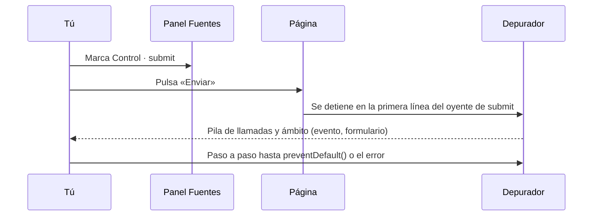

# 7. Pruebas y documentación

[⬅️ Volver a la unidad](./README.md)

## Índice

- [7.1. Qué se añade en esta unidad](#71-qué-se-añade-en-esta-unidad)
- [7.2. Depurar eventos](#72-depurar-eventos)
  - [7.2.1. Ver los oyentes de un elemento](#721-ver-los-oyentes-de-un-elemento)
  - [7.2.2. Puntos de ruptura de eventos](#722-puntos-de-ruptura-de-eventos)
  - [7.2.3. Vigilar eventos desde la consola](#723-vigilar-eventos-desde-la-consola)
- [7.3. Probar validadores](#73-probar-validadores)
- [7.4. Probar eventos simulados](#74-probar-eventos-simulados)
  - [7.4.1. Lanzar eventos en los tests](#741-lanzar-eventos-en-los-tests)
  - [7.4.2. Comprobar que se llama a un oyente: `vi.fn()`](#742-comprobar-que-se-llama-a-un-oyente-vifn)
  - [7.4.3. Probar un formulario](#743-probar-un-formulario)
  - [7.4.4. El tiempo en los tests: temporizadores falsos](#744-el-tiempo-en-los-tests-temporizadores-falsos)
- [7.5. Documentar validadores y eventos](#75-documentar-validadores-y-eventos)
- [7.6. Ejemplo integrador: probar un buscador con _debounce_](#76-ejemplo-integrador-probar-un-buscador-con-debounce)
- [Resumen](#resumen)
- [Ejercicios de reflexión](#ejercicios-de-reflexión)

> **CE que trabaja este tema:** RA5 h.

---

## 7.1. Qué se añade en esta unidad

| | UD5 | UD6 (este tema) |
|---|---|---|
| **Depuración** | Panel Elementos y puntos de ruptura de DOM | **Puntos de ruptura de eventos**, oyentes de un elemento y `monitorEvents` |
| **Documentación** | Componentes de interfaz | **Validadores** (qué aceptan y qué rechazan) y **eventos** que emite un componente |
| **Pruebas** | Tests de DOM con happy-dom | **Tests de validadores** con tablas de casos y **de eventos simulados**, con `vi.fn()` y temporizadores falsos |

El CE h pide **probar y documentar** el código. En una aplicación con eventos y formularios, lo que más falla son los validadores (un caso límite que nadie probó) y los oyentes (un evento que no llega, que llega dos veces o que llega tarde). Este tema da las herramientas para encontrarlo y evitarlo.

---

## 7.2. Depurar eventos

### 7.2.1. Ver los oyentes de un elemento

En el panel **Elementos**, selecciona un elemento y abre la pestaña **Event Listeners** (Oyentes de eventos) del panel lateral:

| Qué muestra | Para qué |
|-------------|----------|
| Los oyentes por tipo de evento, del elemento **y de sus ascendientes** (casilla *Ancestors*) | Ver quién recibe sus eventos por delegación |
| El fichero y la línea de cada oyente | Ir directamente al código |
| Si es `passive` o de captura | Explicar por qué `preventDefault()` no hace nada |
| Un botón **Remove** | Quitar un oyente para comprobar si es el culpable |

En la consola de Chrome, `getEventListeners($0)` devuelve los oyentes del elemento seleccionado como un objeto.

### 7.2.2. Puntos de ruptura de eventos

En **Fuentes** → **Event Listener Breakpoints** (Puntos de interrupción de los objetos de escucha de eventos) se marca un tipo o una categoría entera (**Mouse → click**, **Keyboard → keydown**, **Control → submit**). La ejecución se detiene en el **primer oyente** que se ejecute para ese evento, en cualquier elemento.



El diagrama muestra el uso típico: marcar el evento, reproducir la acción y seguir paso a paso el oyente que responde, sin saber de antemano en qué fichero está.

> 💡 **Tip del Examinador**: "Un formulario recarga la página en lugar de mostrar el resumen. ¿Cómo lo depuras?" → Con un punto de ruptura de eventos en **submit**: si la ejecución no se detiene, no hay oyente (o está en otro elemento); si se detiene, se sigue paso a paso para ver si se llega al `preventDefault()` o salta un error antes. Marcar **Preserve log** en la consola conserva los mensajes aunque la página se recargue.

### 7.2.3. Vigilar eventos desde la consola

`monitorEvents` (en la consola de Chrome) muestra cada evento de un elemento sin escribir oyentes:

```js
monitorEvents($0, 'key');          // todos los eventos de teclado del elemento seleccionado
monitorEvents(window, ['resize', 'scroll']);
unmonitorEvents($0);               // dejar de vigilar
```

Es la forma más rápida de comprobar **qué eventos** se lanzan, **en qué orden** y **con qué datos** al hacer algo (pegar, arrastrar, autocompletar un campo).

> ⚠️ **Cuidado**: Con un punto de ruptura parado, los eventos de foco y de teclado se comportan distinto: al ir a DevTools, la página **pierde el foco** y se lanza `blur`. Para depurar `focus`, `blur` o `keyup`, usa `console.log` o `monitorEvents` en lugar de detener la ejecución.

---

## 7.3. Probar validadores

Los validadores son **funciones puras**: reciben un texto y devuelven un resultado. Son lo más fácil de probar y lo más rentable, porque es donde se esconden los casos límite. `it.each` (UD3) prueba una **tabla de casos** con un solo test:

```js
// tests/documento.test.js
import { describe, it, expect } from 'vitest';
import { esDocumentoValido } from '../js/documento.js';

describe('esDocumentoValido', () => {
  it.each([
    ['12345678Z', 'DNI válido'],
    ['00000000T', 'DNI con ceros a la izquierda'],
    ['X1234567L', 'NIE con X'],
    ['Y0000000Z', 'NIE con Y'],
    ['12345678z', 'letra en minúscula'],
    [' 12345678-Z ', 'con espacios y guion'],
  ])('acepta %s (%s)', (documento) => {
    expect(esDocumentoValido(documento)).toBe(true);
  });

  it.each([
    ['12345678A', 'letra de control incorrecta'],
    ['1234567Z', 'DNI con siete cifras'],
    ['X12345678L', 'NIE con ocho cifras'],
    ['W1234567L', 'letra inicial que no es X, Y ni Z'],
    ['12345678', 'sin letra'],
    ['', 'vacío'],
  ])('rechaza %s (%s)', (documento) => {
    expect(esDocumentoValido(documento)).toBe(false);
  });
});
```

| Qué casos incluir | Ejemplo |
|-------------------|---------|
| Válidos típicos | `12345678Z` |
| Válidos en los **límites** | `00000000T`, longitud mínima y máxima exacta |
| Variantes que se deben aceptar | Minúsculas, espacios, guiones |
| No válidos **por cada regla** | Uno por cada motivo de rechazo: letra, longitud, prefijo |
| Justo fuera del límite | 7 caracteres si el mínimo es 8 |
| Vacío | `''` |

> ✅ **Buena práctica**: Pon un **motivo** en cada caso de la tabla (`'letra de control incorrecta'`). Cuando un test falla, el nombre dice qué regla se ha roto, y la tabla sirve a la vez de **documentación** de qué acepta el validador.

---

## 7.4. Probar eventos simulados

> 📝 **Nota del Profesor**: Los tests del apartado 7.3 son **unitarios**: prueban un validador aislado, una función que recibe un texto y devuelve un resultado. Los de este apartado son **de integración** (la pirámide de pruebas de la UD1, tema 6): comprueban juntos el HTML, tus oyentes y el DOM simulado, como los de la UD5. Conviene tener de los dos tipos: si falla un unitario, sabes qué función está mal; si falla uno de integración con los unitarios en verde, el problema está en cómo encajan las piezas (un `id` cambiado, un oyente sin registrar).

### 7.4.1. Lanzar eventos en los tests

En los tests de DOM (con happy-dom, como en la UD5) el usuario no existe: los eventos se **lanzan** con `dispatchEvent` usando la interfaz que corresponde.

| Para simular | Código |
|--------------|--------|
| Un clic | `boton.click()` |
| Escribir en un campo | `campo.value = 'texto';` y `campo.dispatchEvent(new Event('input', { bubbles: true }))` |
| Confirmar un cambio | `campo.dispatchEvent(new Event('change', { bubbles: true }))` |
| Salir del campo | `campo.dispatchEvent(new FocusEvent('focusout', { bubbles: true }))` o `campo.focus()` y `campo.blur()` |
| Pulsar una tecla | `document.dispatchEvent(new KeyboardEvent('keydown', { key: 's', ctrlKey: true, bubbles: true }))` |
| Enviar un formulario | `formulario.requestSubmit()` (valida y lanza `submit`) o `formulario.dispatchEvent(new Event('submit', { bubbles: true, cancelable: true }))` |
| Un evento propio | `elemento.dispatchEvent(new CustomEvent('nombre', { detail, bubbles: true }))` |

> ⚠️ **Cuidado**: Pon `bubbles: true` si el oyente está en un ascendiente (delegación), y `cancelable: true` si el código llama a `preventDefault()` y quieres comprobarlo con `evento.defaultPrevented`. Sin ellos, el evento no sube o no se puede cancelar, y el test falla por un motivo que no es el que crees.

### 7.4.2. Comprobar que se llama a un oyente: `vi.fn()`

`vi.fn()` crea una **función espía** (*mock*) que recuerda cuántas veces se la llamó y con qué argumentos. Sirve para comprobar que un componente **emite** un evento o llama a un callback:

```js
import { it, expect, vi } from 'vitest';

it('emite carritoactualizado con las unidades', () => {
  const oyente = vi.fn();
  document.addEventListener('carritoactualizado', oyente);

  anadirAlCarrito(carrito, { id: 7, precio: 19.95 });

  expect(oyente).toHaveBeenCalledTimes(1);
  expect(oyente.mock.calls[0][0].detail).toEqual({ unidades: 1, total: 19.95 });
  document.removeEventListener('carritoactualizado', oyente);
});
```

| Comprobación | Qué verifica |
|--------------|--------------|
| `toHaveBeenCalled()` | Se llamó al menos una vez |
| `toHaveBeenCalledTimes(n)` | Se llamó exactamente n veces (detecta oyentes duplicados) |
| `toHaveBeenCalledWith(…)` | Con esos argumentos |
| `oyente.mock.calls[i][j]` | El argumento j de la llamada i (el objeto evento) |
| `not.toHaveBeenCalled()` | No se llamó (por ejemplo, tras `destruir()`) |

### 7.4.3. Probar un formulario

```js
// tests/contacto.test.js
import { describe, it, expect, beforeEach, vi } from 'vitest';
import { iniciarContacto } from '../js/contacto.js';

describe('formulario de contacto', () => {
  let formulario;
  let alEnviar;

  beforeEach(() => {
    document.body.innerHTML = `
      <form id="contacto" novalidate>
        <input name="correo" type="email" required aria-describedby="correo-error">
        <p id="correo-error"></p>
        <button>Enviar</button>
      </form>`;
    formulario = document.querySelector('#contacto');
    alEnviar = vi.fn();
    iniciarContacto(formulario, alEnviar); // recibe el formulario y qué hacer con los datos
  });

  const escribir = (nombre, valor) => {
    const campo = formulario.elements[nombre];
    campo.value = valor;
    campo.dispatchEvent(new Event('input', { bubbles: true }));
    campo.dispatchEvent(new FocusEvent('focusout', { bubbles: true }));
  };

  it('muestra el error al salir de un campo no válido', () => {
    escribir('correo', 'ana@');
    expect(formulario.elements.correo.getAttribute('aria-invalid')).toBe('true');
    expect(document.querySelector('#correo-error').textContent).toContain('correo');
  });

  it('no envía si hay errores y enfoca el primero', () => {
    formulario.requestSubmit();
    expect(alEnviar).not.toHaveBeenCalled();
    expect(document.activeElement).toBe(formulario.elements.correo);
  });

  it('envía los datos si todo es válido', () => {
    escribir('correo', 'ana@ejemplo.es');
    formulario.requestSubmit();
    expect(alEnviar).toHaveBeenCalledWith({ correo: 'ana@ejemplo.es' });
  });
});
```

Igual que en la UD5, la función **recibe** el formulario y un callback (`alEnviar`) en lugar de buscarlos con `document.querySelector` y enviar por su cuenta: así el test le pasa el HTML que quiere y un espía en vez del envío real.

### 7.4.4. El tiempo en los tests: temporizadores falsos

Un oyente con _debounce_ o un envío simulado con `setTimeout` no se puede probar esperando de verdad: los tests serían lentos y frágiles. Vitest tiene **temporizadores falsos** (*fake timers*) que controlan el reloj:

| Función | Qué hace |
|---------|----------|
| `vi.useFakeTimers()` | Sustituye `setTimeout`, `setInterval` y `Date` por versiones controladas |
| `vi.advanceTimersByTime(ms)` | Avanza el reloj `ms` milisegundos y ejecuta lo que toque |
| `vi.runAllTimers()` | Ejecuta todos los temporizadores pendientes |
| `vi.useRealTimers()` | Vuelve a los reales (en `afterEach`) |

```js
import { describe, it, expect, vi, beforeEach, afterEach } from 'vitest';
import { debounce } from '../js/tiempo.js';

describe('debounce', () => {
  beforeEach(() => vi.useFakeTimers());
  afterEach(() => vi.useRealTimers());

  it('ejecuta una sola vez, con los últimos argumentos, cuando paran las llamadas', () => {
    const funcion = vi.fn();
    const conRebote = debounce(funcion, 300);

    conRebote('p');
    vi.advanceTimersByTime(200);
    conRebote('pa');
    vi.advanceTimersByTime(200);
    conRebote('pan');
    expect(funcion).not.toHaveBeenCalled();

    vi.advanceTimersByTime(300);
    expect(funcion).toHaveBeenCalledTimes(1);
    expect(funcion).toHaveBeenCalledWith('pan');
  });
});
```

---

## 7.5. Documentar validadores y eventos

**Validadores.** Además del JSDoc de cada función (`@param`, `@returns`, `@example`), su documentación debe decir **qué acepta y qué rechaza**, con ejemplos. La mejor forma es una tabla en el README que coincida con los casos de los tests:

| Validador | Acepta | Rechaza |
|-----------|--------|---------|
| `esDocumentoValido` | `12345678Z`, `x1234567l`, `12345678-Z` | `12345678A` (letra), `1234567Z` (longitud), `W1234567L` (prefijo) |
| `codigoPostal` | `01001`, `52080` | `00100`, `53001`, `4100` |

**Eventos.** JSDoc tiene etiquetas para los eventos de un componente:

| Etiqueta | Para |
|----------|------|
| `@fires nombre` | El evento que **emite** una función (`@fires carrito#carritoactualizado`) |
| `@listens nombre` | Los eventos que **escucha** |
| `@event nombre` | La **definición** del evento: cuándo se lanza y qué lleva su `detail` |

```js
/**
 * Se lanza cuando cambian las unidades del carrito.
 * @event module:carrito#carritoactualizado
 * @type {CustomEvent}
 * @property {{ unidades: number, total: number }} detail
 */

/**
 * Añade un producto al carrito y avisa al resto de la página.
 * @param {HTMLElement} carrito
 * @param {{ id: number, precio: number }} producto
 * @fires module:carrito#carritoactualizado
 */
export function anadirAlCarrito(carrito, producto) { /* … */ }
```

Al generar la documentación con `npm run docs` (UD3), los eventos aparecen en su propia sección del módulo.

> 📝 **Nota del Profesor**: Documentar los eventos es documentar el **contrato** de un componente con el resto de la aplicación: si cambias el nombre del evento o lo que lleva el `detail`, rompes a quien lo escucha, igual que si cambias los parámetros de una función. En la UD7 harás lo mismo con el contrato de una API.

---

## 7.6. Ejemplo integrador: probar un buscador con _debounce_

Un buscador que filtra una lista al dejar de escribir, documentado y con sus tests. Junta los eventos simulados, los temporizadores falsos y `vi.fn()`.

```js
// js/buscador.js
import { debounce } from './tiempo.js';

/**
 * Buscador con rebote: filtra los `<li>` de una lista cuando el usuario deja de escribir.
 *
 * HTML necesario: un `<input type="search">` y una `<ul>` con un `<li>` por elemento.
 * Estado: `hidden` en los `<li>` que no coinciden.
 *
 * @param {HTMLInputElement} campo
 * @param {HTMLUListElement} lista
 * @param {{ espera?: number, alFiltrar?: function(number): void }} [opciones] `alFiltrar` recibe cuántos quedan visibles.
 * @listens input
 */
export function iniciarBuscador(campo, lista, { espera = 300, alFiltrar = () => {} } = {}) {
  const filtrar = () => {
    const texto = campo.value.trim().toLowerCase();
    let visibles = 0;
    for (const elemento of lista.children) {
      elemento.hidden = !elemento.textContent.toLowerCase().includes(texto);
      if (!elemento.hidden) visibles++;
    }
    alFiltrar(visibles);
  };
  campo.addEventListener('input', debounce(filtrar, espera));
}
```

```js
// tests/buscador.test.js
import { describe, it, expect, beforeEach, afterEach, vi } from 'vitest';
import { iniciarBuscador } from '../js/buscador.js';

describe('iniciarBuscador', () => {
  let campo;
  let alFiltrar;
  const visibles = () => [...document.querySelectorAll('li:not([hidden])')].map((li) => li.textContent);
  const escribir = (texto) => {
    campo.value = texto;
    campo.dispatchEvent(new Event('input'));
  };

  beforeEach(() => {
    vi.useFakeTimers();
    document.body.innerHTML = `
      <input type="search" id="buscar">
      <ul id="lista"><li>Pan</li><li>Panela</li><li>Leche</li></ul>`;
    campo = document.querySelector('#buscar');
    alFiltrar = vi.fn();
    iniciarBuscador(campo, document.querySelector('#lista'), { alFiltrar });
  });

  afterEach(() => vi.useRealTimers());

  it('no filtra mientras se escribe', () => {
    escribir('pa');
    vi.advanceTimersByTime(299);
    expect(visibles()).toEqual(['Pan', 'Panela', 'Leche']);
    expect(alFiltrar).not.toHaveBeenCalled();
  });

  it('filtra una sola vez cuando se deja de escribir, sin distinguir mayúsculas', () => {
    escribir('p');
    escribir('pA');
    escribir('pAn');
    vi.advanceTimersByTime(300);
    expect(visibles()).toEqual(['Pan', 'Panela']);
    expect(alFiltrar).toHaveBeenCalledTimes(1);
    expect(alFiltrar).toHaveBeenCalledWith(2);
  });

  it('vuelve a mostrar todo al borrar el texto', () => {
    escribir('leche');
    vi.advanceTimersByTime(300);
    escribir('');
    vi.advanceTimersByTime(300);
    expect(visibles()).toHaveLength(3);
  });
});
```

```text
// Salida de npm test:
 ✓ tests/buscador.test.js (3 tests)

 Test Files  1 passed (1)
      Tests  3 passed (3)
```

| Técnica | Dónde |
|---------|-------|
| Documentar el componente | HTML necesario, estado y `@listens` |
| Inyectar dependencias | `campo`, `lista` y el callback `alFiltrar` como parámetros |
| Simular al usuario | `value` + `dispatchEvent(new Event('input'))` |
| Controlar el tiempo | `vi.useFakeTimers()` y `advanceTimersByTime` |
| Comprobar llamadas | `vi.fn()` con `toHaveBeenCalledTimes` y `toHaveBeenCalledWith` |
| Probar el límite | `299` ms no filtra; `300` sí |

---

## Resumen

- La pestaña **Event Listeners** del panel Elementos muestra los oyentes de un elemento y de sus ascendientes; `getEventListeners($0)` los devuelve en la consola.
- Los **puntos de ruptura de eventos** (panel Fuentes) detienen la ejecución en el primer oyente de un tipo; `monitorEvents` muestra los eventos que se lanzan.
- Los **validadores** se prueban con tablas `it.each` de casos válidos, no válidos por cada regla y en los límites, cada uno con su motivo.
- Los **eventos** se simulan con `click()`, `dispatchEvent` (con `bubbles` y `cancelable` cuando hagan falta) y `requestSubmit()`.
- `vi.fn()` comprueba que se llama a un oyente o callback, cuántas veces y con qué datos.
- Los **temporizadores falsos** (`vi.useFakeTimers`, `advanceTimersByTime`) prueban el _debounce_ y los envíos simulados sin esperar.
- Documenta qué aceptan y rechazan los validadores (con ejemplos) y qué eventos emite y escucha cada componente (`@fires`, `@listens`, `@event`).

## Ejercicios de reflexión

1. Abre una página con muchos oyentes (cualquier web conocida) y mira la pestaña Event Listeners de un botón. ¿Cuántos oyentes tiene? ¿Cuántos son de sus ascendientes?
2. Usa `monitorEvents` sobre un campo de texto y pega un texto con el ratón. ¿Qué eventos se lanzan y en qué orden?
3. Escribe la tabla de casos (válidos y no válidos, con su motivo) para un validador de matrículas sin escribir el código. ¿Cuántos casos necesitas para cubrir cada regla?
4. ¿Por qué un test de un _debounce_ que usa `await new Promise((r) => setTimeout(r, 300))` es peor que uno con temporizadores falsos?
5. Un test simula `submit` con `new Event('submit')` y comprueba `evento.defaultPrevented`, pero siempre da `false`. ¿Qué le falta?

---

[⬅️ Volver a la unidad](./README.md)
