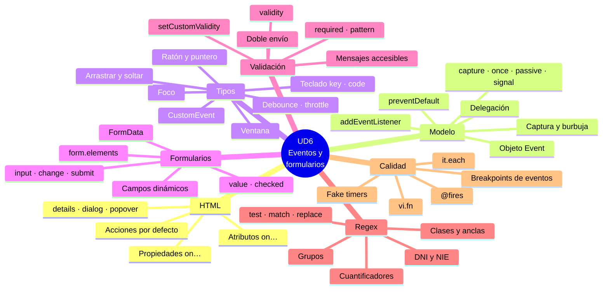

# 8. Resumen y mapa mental

[⬅️ Volver a la unidad](./README.md)

- [8. Resumen y mapa mental](#8-resumen-y-mapa-mental)
  - [Resumen ejecutivo](#resumen-ejecutivo)
  - [Mapa mental](#mapa-mental)
  - [Checklist de evaluación](#checklist-de-evaluación)
    - [El HTML y los eventos (CE a)](#el-html-y-los-eventos-ce-a)
    - [El modelo de eventos (CE b)](#el-modelo-de-eventos-ce-b)
    - [Tipos de eventos y código que los usa (CE c, d)](#tipos-de-eventos-y-código-que-los-usa-ce-c-d)
    - [Formularios desde el código (CE e)](#formularios-desde-el-código-ce-e)
    - [Validación con eventos (CE f)](#validación-con-eventos-ce-f)
    - [Expresiones regulares (CE g)](#expresiones-regulares-ce-g)
    - [Pruebas y documentación (CE h)](#pruebas-y-documentación-ce-h)

## Resumen ejecutivo

En esta unidad has aprendido a **hacer que una página responda al usuario** y a **recoger y validar sus datos**:

1. **Eventos en el HTML**: las acciones por defecto, los elementos que ya son interactivos (`
`, `<dialog>`, `popover`, validación nativa), los atributos `on…` y las propiedades `on…`, y por qué se usa `addEventListener`.
2. **El modelo de eventos**: `addEventListener` y sus opciones (`capture`, `once`, `passive`, `signal`), el objeto `Event`, la propagación en tres fases (captura, objetivo y burbuja), `preventDefault` y `stopPropagation`, la delegación y `this` en los oyentes.
3. **Tipos de eventos**: ratón, puntero, táctiles, teclado (`key` y `code`), foco, formulario, ventana, portapapeles, arrastrar y soltar, eventos propios con `CustomEvent`, y _debounce_ y _throttle_.
4. **Formularios desde el código**: `form.elements`, leer y escribir cada tipo de campo, `FormData`, los eventos `input`, `change`, `submit` y `reset`, modificar apariencia y comportamiento, y campos dinámicos.
5. **Validación y envío**: validación nativa, la API de validación de restricciones (`validity`, `setCustomValidity`), cuándo mostrar los errores, mensajes accesibles, envío interceptado y doble envío.
6. **Expresiones regulares**: sintaxis, _flags_, `test`, `match`, `matchAll`, `replace`, el atributo `pattern` y los patrones habituales, con la letra de control del DNI y el NIE.
7. **Pruebas y documentación**: oyentes y puntos de ruptura de eventos en DevTools, tests de validadores con tablas de casos, eventos simulados, `vi.fn()`, temporizadores falsos y documentar validadores y eventos.

## Mapa mental

## Checklist de evaluación

### El HTML y los eventos (CE a)

- [ ] Conozco las acciones por defecto de los eventos más habituales (enlaces, formularios, casillas)
- [ ] Uso elementos que el HTML ya hace interactivos (`
`, `<dialog>`, `popover`) y escucho sus eventos
- [ ] Explico cómo funcionan los atributos `on…` (`event`, `this`, `return false`)
- [ ] Sé por qué no se usan los atributos `on…` y qué limita a las propiedades `on…`
- [ ] Migro una página con atributos `on…` a `addEventListener`

### El modelo de eventos (CE b)

- [ ] Registro oyentes con `addEventListener` y sus opciones `capture`, `once`, `passive` y `signal`
- [ ] Quito oyentes con `removeEventListener` o con un `AbortController`
- [ ] Uso las propiedades del objeto evento: `type`, `target`, `currentTarget`, `eventPhase`, `isTrusted`
- [ ] Explico las tres fases de la propagación y el orden de los oyentes
- [ ] Distingo `preventDefault()` de `stopPropagation()`
- [ ] Sé qué eventos no suben y uso sus alternativas (`focusin`, `focusout`)
- [ ] Aplico la delegación con `closest` y atributos `data-*`
- [ ] Controlo `this` en los oyentes y les paso datos con closures

### Tipos de eventos y código que los usa (CE c, d)

- [ ] Clasifico los eventos en familias y sé qué interfaz usa cada una
- [ ] Uso los eventos de ratón y de puntero, también para arrastrar con `setPointerCapture`
- [ ] Programo atajos de teclado con `key`, `code` y los modificadores, sin interferir al escribir
- [ ] Uso los eventos de foco, de ventana (`visibilitychange`, `beforeunload`) y de portapapeles
- [ ] Programo una zona de arrastrar y soltar con alternativa
- [ ] Emito y escucho eventos propios con `CustomEvent`
- [ ] Aplico _debounce_ y _throttle_ a los eventos muy frecuentes

### Formularios desde el código (CE e)

- [ ] Accedo a los campos con `form.elements` y conozco la `RadioNodeList`
- [ ] Leo y escribo cada tipo de campo (`value`, `valueAsNumber`, `checked`, `selectedOptions`)
- [ ] Recojo los datos con `FormData` y sé qué campos no incluye
- [ ] Escucho `input`, `change`, `submit` y `reset` en el formulario
- [ ] Cambio el comportamiento con `disabled`, `readOnly`, `required`, `hidden` y `focus()`
- [ ] Añado y quito campos dinámicamente desde un `<template>`

### Validación con eventos (CE f)

- [ ] Sé por qué la validación del cliente no sustituye a la del servidor
- [ ] Uso los atributos de validación del HTML y las pseudoclases `:user-valid` y `:user-invalid`
- [ ] Uso `validity`, `checkValidity()`, `setCustomValidity()` y `novalidate`
- [ ] Valido en `focusout`, revalido en `input` y valido todo en `submit`
- [ ] Muestro mensajes accesibles con `aria-invalid` y `aria-describedby`, y enfoco el primer error
- [ ] Intercepto el envío, recojo los datos y evito el doble envío

### Expresiones regulares (CE g)

- [ ] Creo expresiones regulares con literales y con `RegExp`
- [ ] Uso clases, anclas, cuantificadores, grupos, alternativas y comprobaciones
- [ ] Conozco los _flags_ y la trampa de `lastIndex` con `g`
- [ ] Uso `test`, `match`, `matchAll`, `replace` y `split`
- [ ] Uso el atributo `pattern` y sé en qué se diferencia de una expresión de JavaScript
- [ ] Valido DNI, NIE, código postal, teléfono, correo y contraseña, con la letra de control del DNI y el NIE
- [ ] Escapo el texto del usuario antes de meterlo en un patrón

### Pruebas y documentación (CE h)

- [ ] Encuentro los oyentes de un elemento y uso los puntos de ruptura de eventos
- [ ] Pruebo validadores con tablas de casos válidos, no válidos y límite
- [ ] Simulo eventos en los tests con `dispatchEvent` y `requestSubmit()`
- [ ] Compruebo oyentes y callbacks con `vi.fn()`
- [ ] Pruebo código con temporizadores usando temporizadores falsos
- [ ] Documento qué aceptan los validadores y qué eventos emite un componente

---

[⬅️ Volver a la unidad](./README.md)
