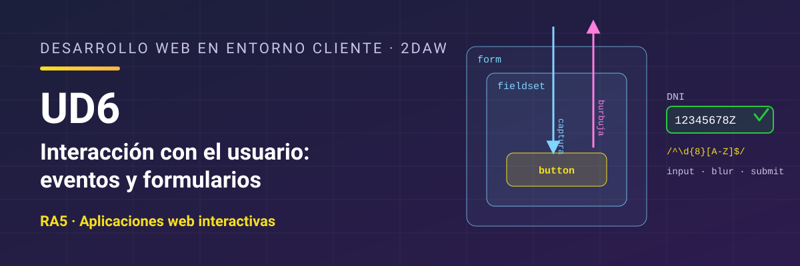

# Desarrollo Web en Entorno Cliente - UD6 Interacción con el usuario: eventos y formularios

Unidad 6 Interacción con el usuario: eventos y formularios. 2DAW.

## Resultado de aprendizaje

Esta unidad trabaja el **RA5** y sus criterios de evaluación: [ver resultado de aprendizaje y criterios de evaluación](./resultados-aprendizaje.md).

## Referencias

- [*Eloquent JavaScript*](https://www.eloquentjavascript.es/), de Marijn Haverbeke (4.ª edición, traducida al español por midudev; licencia CC BY-NC). Libro gratuito en línea que explica el lenguaje y el navegador con otro enfoque y trae ejercicios. Es una buena lectura complementaria para cualquier unidad del curso. Ten en cuenta que llama **enlace** (*binding*) a lo que en el curso llamamos **variable** o **constante**, que usa comillas dobles y, a veces, `prompt`, y que la traducción tiene alguna errata. Si algo no cuadra, consulta el original en inglés en [eloquentjavascript.net](https://eloquentjavascript.net/).

## Contenidos

1. [Eventos en el HTML](./01-eventos-html.md)
2. [El modelo de eventos](./02-modelo-eventos.md)
3. [Tipos de eventos](./03-tipos-eventos.md)
4. [Formularios desde el código](./04-formularios.md)
5. [Validación y envío](./05-validacion.md)
6. [Expresiones regulares](./06-expresiones-regulares.md)
7. [Pruebas y documentación](./07-pruebas-documentacion.md)
8. [Resumen](./08-resumen.md)

## Licencia

Este material se distribuye bajo licencia **Creative Commons BY-NC-SA 4.0**. Consulta las condiciones en [LICENSE.md](./LICENSE.md).
